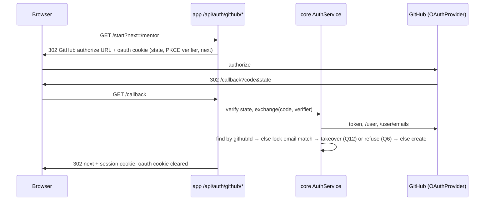
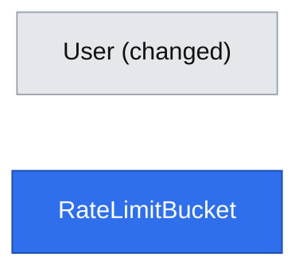

# E01-S01 — Sign in with GitHub or email and password; access by role

- **Date:** 2026-10-31
- **Status:** design complete; review corrections applied (2026-10-31); grilling decisions applied (2026-10-31). Ready for implementation as three PRs merged to `main` in order, one per phase.
- **Issue:** #11 (E01-S01), epic #5 (E01). Depends on: none. Unblocks #12.
- **Builds on:** [platform primitives](2026-10-31-platform-primitives.md), phases PP1 and PP1b, which this story implements.
- **Design authority:** `.ai/specs/product-brief.md` (R06, R07, R35), `AGENTS.md`, `.ai/docs/engineering-standards.md`

## 📝 TLDR

Mentees, mentors and the operator need accounts, and today nobody can sign in: `User` has only `email` and `name`, and no route issues a session.

The plan is for anyone to sign in with GitHub (an account is created on first sign-in), or register and sign in with email and password as the fallback (R06). Everyone is a mentee. The `mentor` role is granted only through an invitation (the grant flow ships in #12), and the `operator` role through a CLI script. Mentor screens refuse non-mentors (R07), and operator screens and `/api/users` refuse non-operators (R35).

## Resolved at the gate (2026-10-31)

| # | Decision |
|---|---|
| Q1 | Primitives are designed in the primitives spec and built with their first consumer. This story builds PP1. |
| Q2 | Amend the standards: fixed roles `mentee`, `mentor`, `operator` with code-level policies, and no RBAC tables. |
| Q3 | A user holds a set of roles. `mentee` is always present, and `mentor` and `operator` are added on top. |
| Q4 | The first operator is granted by CLI: `npm run operator:grant -- <email>`. Review hardening: it grants only to an account with a linked GitHub identity (`githubId` and `emailVerifiedAt` set). An unverified password account could belong to anyone who typed that email. Grilling (2026-10-31): an explicit `--allow-unverified` flag overrides this for local development, with a Polish warning and a log entry; it never depends on `NODE_ENV`. |
| Q5 | Our own authorization-code flow with `state` and PKCE, behind an `OAuthProvider` port with a GitHub adapter. No new dependency. |
| Q6 | An existing GitHub identity signs in by `githubId`. Otherwise, if its email matches an account already linked or verified, refuse. Q12 narrows this: an unverified, unlinked account is taken over instead. Explicit linking from the account page preserves the password only when the GitHub primary verified email matches the normalized account email; a different email is refused. |
| Q7 | No email verification in 1.0. `emailVerifiedAt` is set only from a GitHub-verified email. #12 redeems invitations by single-use link, never by email match. |
| Q8 | The JWT carries `sub` + `sv` (session version). Roles and the version are loaded from the database on every request. |
| Q9 | `(auth)`, `(mentee)`, `(mentor)` and `backend` use shadcn. `(marketing)` stays plain Tailwind. |
| Q10 | Two specs: this one and the primitives spec. |
| Q11 | Registering with an email that already has an account answers 409 „Konto z tym adresem już istnieje. Zaloguj się.” This disclosure is accepted, with per-IP and per-email rate limits on register, until verification email lands with the notification port (#23). `engineering-standards.md` ("Auth error messages") records it as a known limitation. Login errors stay generic. |
| Q12 | A GitHub-verified email takes precedence over an **unverified, unlinked** password account. On first GitHub sign-in the account's `password_hash` is cleared, its `session_version` is bumped (every existing session ends), and the GitHub identity is linked with `emailVerifiedAt` set. This is logged without the email, and the user lands on `/account?notice=github_linked` with the text „Połączyliśmy konto z GitHub. Hasło ustawione wcześniej dla tego adresu zostało usunięte.” Raised by the review as the standard defence against account pre-hijacking. |

Review amendments authorized on 2026-10-31: matching verified email is required for explicit linking; linking and takeover serialize on the same user row; login limits count every admitted attempt atomically. These replace the earlier unmatched-email linking and failure-only rate-limit designs.

## 📝 Problem Statement

Mentees and mentors need an account. GitHub is the chosen sign-in because "my GitHub is my profile" (D07/R06). Email and password cover people without GitHub. Mentors join only by invitation (R07), and the operator works through screens (R35), so role checks must exist before any mentor or operator screen is built (#12–#15).

Evidence note: `research/D07-login.md` in this repository contains a sources readme, not the D07 record (see lesson `2026-10-26-research-files-not-trustworthy-by-name`). R06 in the product brief is the authority used here.

## 📝 Proposed Solution

JSON routes use `apiRoute` / `respond`; OAuth navigations use `browserRoute`, `redirectTo` for local destinations and `redirectToProvider(TrustedProviderUrl)` for the configured GitHub authorization endpoint. These PP1 helpers serialize cookies and responses. User-provided `next` never becomes a provider URL. OAuth exchange completes before a database transaction is opened.

Alternatives that lost (see the primitives spec):
- **Auth.js / `arctic`:** we write our own code instead (Q5).
- **Roles in the JWT:** roles are read from the database (Q8).
- **Automatic linking that preserves an unverified password:** refused (Q6); Q12 deliberately replaces that credential only after verified-email proof.

## 📝 Architecture

New or changed files. "PP1" marks a platform primitive built here; it is specified in the primitives spec.

| Package | File | Responsibility |
|---|---|---|
| db | `entities/auth/user.entity.ts` | new columns (Data Model) |
| db | `entities/platform/rate-limit-bucket.entity.ts` | PP1 / P6 |
| core | `http/access.ts`, `http/api-route.ts`, `http/browser-route.ts`, `http/respond.ts`, `http/errors.ts` | PP1 / P1; shared execution with separate JSON/browser response handling |
| core | `services/platform/{clock,rate-limit.service}.ts` | PP1 / P5, P6; role-only gates reuse `Access` and `hasRole` |
| core | `services/auth/session.service.ts` | `issue`, `resolve` (P1 contract) and `revokeAll(userId)` (bumps `sessionVersion`) |
| core | `services/auth/auth.service.ts` | `register`, `signInWithPassword`, `signInWithGitHub`, `linkGitHub`, `signOut` |
| core | `services/auth/password-hasher.ts` | `bcryptjs`, cost 12, plus a constant dummy hash so unknown emails take the same time |
| core | `services/auth/oauth-provider.port.ts` | `authorizationUrl({ state, codeChallenge, redirectUri }) → TrustedProviderUrl`, `exchange({ code, codeVerifier, redirectUri }) → ExternalIdentity`; authorization URL validated against the configured OAuth endpoint's exact origin/path, HTTPS except configured loopback HTTP for tests |
| core | `services/auth/adapters/github-oauth-provider.ts` | token endpoint, `GET /user`, `GET /user/emails` (primary and verified only); base URLs from env |
| core | `services/auth/adapters/in-memory-oauth-provider.ts` | unit and integration tests |
| core | `services/auth/oauth-state.ts` | signed short-lived state cookie: JWT `{ aud: "oauth-state", state, verifier, next, intent, linkUserId?, linkSessionVersion? }`, 10 min; link fields captured from the verified session at start |
| core | `services/auth/user.service.ts` | adds `findByEmail`, `grantRole(userId, role)`, `revokeRole`; email normalized (trim, lower-case) |
| core | `validators/auth/{register,login}.schema.ts` | shared by route and `CrudForm` (P18) |
| core | `config/env.ts` | `APP_URL`, `GITHUB_CLIENT_ID`, `GITHUB_CLIENT_SECRET`, `GITHUB_OAUTH_URL` (default `https://github.com`), `GITHUB_API_URL` (default `https://api.github.com`), `TRUST_PROXY_HOPS` (int, default 0); all optional. `isGitHubConfigured()` requires all of `APP_URL`, `GITHUB_CLIENT_ID` and `GITHUB_CLIENT_SECRET`. |
| core | `logger.ts` and shared HTTP error logging | redact credentials; log pathname only, never raw OAuth request URLs or vendor response bodies; retain database `err.code` |
| app | `api/auth/{register,login,logout,me}/route.ts` (`apiRoute`), `api/auth/github/{start,callback}/route.ts` (`browserRoute`: every outcome is a 302, never JSON) | wiring only |
| app | `api/users/route.ts` | `access: { anyRole: ["operator"] }` |
| app | `lib/auth/page-scope.ts` | PP1 / P3 |
| app | `(auth)/{layout,login/page,register/page}.tsx` | sign-in screens |
| app | `(mentee)/{layout,account/page}.tsx` | account page: details, connect GitHub, sign out |
| app | `(mentor)/{layout,mentor/page}.tsx` | mentor area entry, gated; #13–#15 fill it in |
| app | `backend/page.tsx` | operator gate and page-rendered `AppShell`; layout stays structural |
| ui | `backend/feedback/AccessDenied.tsx`, `backend/layout/{AppShell,NavLinks}.tsx` | PP1 / P3 |
| ui | `components/auth/{GitHubButton,SignOutButton}.tsx` | concept components used by several pages |
| root | `scripts/operator-grant.ts`, `package.json` script `operator:grant`, `tsx` devDependency | PP1 / P19 |
| test | `support/github-stub.ts`, `support/seed.ts`; `e2e/global-setup.ts` starts the stub and passes `GITHUB_*_URL` | PP1 / P19 |

Dependencies: `bcryptjs` goes into `@devmentor/core` (mandated by the standards), and `tsx` into the root devDependencies. Nothing else.

## 📝 Data Model

`users` (changed):

| Column | Type | Notes |
|---|---|---|
| `email` | `varchar(255)` unique | existing; now always stored trimmed and lower-cased. The migration first fails with a clear message if existing rows differ only by case, then lower-cases them. |
| `name` | `varchar(255)` | existing |
| `password_hash` | `varchar(60)` null | bcrypt; null for GitHub-only accounts |
| `github_id` | `varchar(30)` null, unique | GitHub's numeric user id: the identity key, never the login |
| `github_login` | `varchar(39)` null | display and profile link; refreshed on each GitHub sign-in |
| `roles` | `text[]` not null, default `{mentee}` | check: every element in (`mentee`, `mentor`, `operator`) and `mentee` present |
| `session_version` | `int` not null, default 1 | bumped by `revokeAll` (sign-out, Q12 takeover) |
| `email_verified_at` | `timestamptz` null | set only from a GitHub primary verified email |
| `updated_at` | `timestamptz` not null | `onUpdate` |

`rate_limit_buckets` (new, P6): `key varchar(200)`, `window_start timestamptz`, `expires_at timestamptz`, `count int`, unique `(key, window_start)`, index on `expires_at`. P6's bounded global expiry cleanup also removes keys never used again.

Migration notes:
- The migration is created with `npm run db:migration:create` and the snapshot is committed with it.
- Existing demo rows get `roles = {mentee}` and no credentials, so they cannot sign in. That is intended: there is no production data yet.
- No DB check enforces "at least one credential", because existing rows would violate it. The service enforces it instead.

Sensitive data:
- `password_hash` is never serialized. A `toMe(user)` mapper returns `{ id, name, email, githubLogin, roles }` only.
- No GitHub access token is stored. It is used once inside `exchange` and then discarded.

`RateLimitBucket` has no relation to `User`: its keys are hashed email or IP strings.

## 📝 API Contracts

JSON routes return the envelope; OAuth start/callback always return 302, including errors. Unsafe methods need `x-devmentor-request: 1` (`apiCall` sends it). Unexpected JSON-route failures return 500; the table lists additional endpoint-specific errors.

| Route | Access | Input | Success | Errors |
|---|---|---|---|---|
| `POST /api/auth/register` | public (reason: creates the account) | `{ name: 1–100, email, password: min 12 characters, max 72 UTF-8 bytes }` | 201 `Me` + session cookie | 400 field errors, 409 `conflict` with `fieldErrors.email` „Konto z tym adresem już istnieje. Zaloguj się.” (Q11), 429 |
| `POST /api/auth/login` | public (reason: issues the session) | `{ email, password }` | 200 `Me` + session cookie | 401 „Nieprawidłowy e-mail lub hasło.” (same for unknown email, GitHub-only account, wrong password), 429 |
| `POST /api/auth/logout` | public (reason: missing or expired sessions can still clear their cookie) | — | 200 `null`, cookie cleared; if a valid session was present, commit `revokeAll` first | 403 for missing CSRF header; 500 if session resolution or revocation has an infrastructure failure (do not claim global sign-out succeeded) |
| `GET /api/auth/me` | session | — | 200 `Me` | 401 |
| `GET /api/auth/github/start` | public (reason: starts OAuth; CSRF is protected by `state`) | `?next=<safe path>&intent=signin\|link` | 302 to GitHub + oauth cookie (`path=/api/auth/github`, httpOnly, lax, 600 s) | 302 `/login?error=github_unavailable` when not configured; `intent=link` without a session → 302 `/login` |
| `GET /api/auth/github/callback` | public (reason: OAuth redirect target; checked by `state` + PKCE) | `?code&state` or `?error` | 302 to `next` (or the role default) + session cookie; oauth cookie cleared | 302 `/login?error=<code>`: `github_denied`, `github_state`, `github_no_verified_email`, `github_account_exists`, `github_already_linked`, `github_email_mismatch`, `github_failed`; verified link-intent errors return to `/account?error=`; invalid state goes to `/login` |
| `GET /api/users` | `{ anyRole: ["operator"] }` | — | 200 users (`Me` shape) | 401, 403 |

`Me = { id, name, email, githubLogin: string | null, roles: Role[] }`.

Rules:
- **Password length.** Between 12 characters and 72 bytes. bcrypt silently truncates anything past 72 bytes, so the schema rejects longer input instead.
- **Rate limits.** Named constants, chosen for a small user base:
  - login: 50 attempts per 15 min per IP, 10 attempts per 15 min per (email hash, IP), and 100 attempts per hour per email hash (`consume` before password verification). The pair bucket stops guessing from one IP; the email-only ceiling bounds distributed guessing without letting one IP lock an account out;
  - register: 5 per hour per IP and 3 per hour per email hash (`consume`);
  - GitHub callback: 30 per 15 min per IP (`consume`);
  - when the IP is unknown (`TRUST_PROXY_HOPS=0`), each per-IP limit becomes a route-wide bucket ×10, and the login (email hash, IP) bucket becomes an (email hash, route-wide) bucket with the same 10 per 15 min;
  - consume the IP/global bucket first, then the (email, IP) bucket, then the email-only bucket, so rejected IP traffic cannot create arbitrary email keys;
  - successful attempts count too; no refunds, resets or separate failure counters. If a later bucket refuses, earlier consumption remains;
  - this simpler atomic cap can block correct credentials after repeated attempts, including successful ones. Locking a victim out from one IP blocks only that IP; a lockout from every IP needs 100 attempts per hour, sustained, against the email-only ceiling. The trade-off is documented in P6. GitHub sign-in uses its separate callback limit, but for an unverified, unlinked password account it triggers the Q12 takeover and deletes the password, so it is not a neutral escape from a lockout.
- **`next` handling.** `next` always goes through `safeRedirectPath`. Default destinations: operator → `/backend`, mentor → `/mentor`, otherwise `/account`. This is a temporary mentee home until the mentor list (#16) exists.
- **Redirect URI.** Built from `APP_URL`, never from the `Host` header.
- **GitHub scope.** `read:user user:email`.
- **Session cookie.** Unchanged: `devmentor_session`, httpOnly, secure in production, lax, 24 h. The JWT is `{ aud: "session", sub, sv, auth_time }`, signed HS256 with `AUTH_SECRET`. Sliding renewal per P1: below 12 h remaining, `/api/*` responses re-issue a 24 h token with the same `sv` and `auth_time`, up to `auth_time + 7 d`; after that the user signs in again.
- **Callback re-check.** The callback runs `next` from the state cookie through `safeRedirectPath` again before redirecting.
- **Session failures.** Optional session resolution treats absent, expired or invalid credentials as anonymous, but propagates database/configuration failures. Browser routes map those failures to a generic 302; JSON routes return 500. The callback clears the OAuth cookie on success and error.

`signInWithPassword(email, password)`:
- Consume the IP/global, (normalized email, IP) and normalized-email attempt buckets in that order, then read a snapshot of the user's `password_hash` and `session_version`. Perform bcrypt verification outside a database transaction and without holding a row lock; unknown users and GitHub-only accounts use the dummy hash and receive the same generic 401.
- After successful verification, lock and reload that user row in a short transaction. Require the hash and session version to equal the verified snapshot. If either changed or the user disappeared, return the generic 401 and let the user start a fresh sign-in; do not issue a session from the old credential.
- Issue the token for the version whose credential was verified, never a version reloaded after takeover or revocation. A revocation after this check makes that token stale and the next request refuses it. Tests race password login against both takeover and `revokeAll`, ensuring neither can accidentally upgrade an old password proof to a new session version.

`signInWithGitHub(identity)`:
1. Find a user by `githubId`. If found, refresh `githubLogin` and sign in.
2. Otherwise, if `identity.email` is null (no primary verified email), refuse with `github_no_verified_email`.
3. Otherwise, normalize the verified email and find the matching user. In the same transaction that would change credentials, acquire a write lock on that user row and reload its identity, verification and session-version fields before choosing a branch.
   - No user: go to step 4.
   - If a concurrent operation has already linked the same `githubId`, sign in through step 1 without another takeover.
   - A user still having neither `githubId` nor `emailVerifiedAt` after the lock: take it over (Q12). Clear `password_hash`, set `githubId`, `githubLogin` and `emailVerifiedAt`, overwrite `name` with `identity.name ?? identity.login` (the unverified claimant's name is not kept; the owner can change it later), and atomically increment `session_version`. Commit before issuing the new session. Then redirect to `/account?notice=github_linked`.
   - Otherwise: refuse with `github_account_exists` (Q6). In 1.0 this means the email belongs to an account linked to a *different* GitHub identity.
4. Otherwise, create a user with `{ email, name: identity.name ?? identity.login, githubId, githubLogin, emailVerifiedAt: clock.now(), roles: ["mentee"] }`. A unique-constraint violation from a concurrent first sign-in maps to `github_failed`, and signing in again succeeds through step 1.

`linkGitHub(actor, identity, linkSessionVersion)`:
- At `/start`, capture `linkUserId` and `linkSessionVersion` from the verified session into signed OAuth state. At callback, require the current session to identify the same user and session version. These values never come from unsigned query/body input.
- After exchanging the OAuth code outside the transaction, lock and reload the same user row used by takeover. Inside that transaction, compare the database `session_version` with `linkSessionVersion` again. A mismatch refuses with `github_state`; a session revoked while the OAuth flow or request was in flight cannot link.
- Require a primary verified GitHub email (`github_no_verified_email` if absent), normalized with the same trim/lowercase rule as account emails. It must equal the account email; otherwise refuse with `github_email_mismatch` and leave credentials unchanged.
- If the user already has a different `githubId`, or this identity belongs to another user, refuse with `github_already_linked`. The unique constraint remains the last line of defence, and its conflict maps to the same error.
- Linking the same identity again is idempotent: refresh `githubLogin` without replacing credentials. Otherwise set `githubId`, `githubLogin` and `emailVerifiedAt` together, preserving `password_hash` because both the existing session and matching verified email were proved. Commit before returning.
- `revokeAll` uses an atomic version increment serialized against these user-row mutations. No linking path can restore an older session version or replace a different identity. Integration tests exercise both lock acquisition orders for linking versus takeover/revocation.

## 📝 UI/UX

All copy is in Polish.

**`/login`**
- Primary button „Zaloguj się przez GitHub”.
- Separator „lub”.
- `CrudForm` with fields „E-mail” and „Hasło”, submitting „Zaloguj się”.
- Link „Nie masz konta? Załóż konto”.
- `?error=` is mapped to messages, for example `github_account_exists` → „Ten adres e-mail należy do konta połączonego z innym kontem GitHub.”
- A signed-in visitor is redirected to their default destination.

**`/register`**
- The same GitHub button.
- Fields „Imię i nazwisko”, „E-mail” and „Hasło” (hint: „Co najmniej 12 znaków.”), submitting „Załóż konto”.

**After a form succeeds**
- `window.location.assign(next)`: a full navigation, so server components see the cookie.

**`/account`** (any signed-in user)
- Name, email and roles shown as badges.
- GitHub: either „Połączono z GitHub: @login” or the button „Połącz konto GitHub”.
- The connect action explains „Główny, zweryfikowany adres e-mail na GitHub musi być taki sam jak adres tego konta.” `github_email_mismatch` shows „Adres e-mail konta GitHub nie zgadza się z adresem tego konta.” No credential is changed on refusal.
- „Wyloguj się”.

**`/mentor`**
- The heading „Panel mentora” and the line „Tu pojawią się Twój profil, ceny i terminy.”
- Non-mentors get `AccessDenied`: „Nie masz dostępu do tej strony.”, with the explanation „Mentorzy dołączają tylko z zaproszenia.” (R07).

**`/backend`**
- Gated to the operator. Others see `AccessDenied`.

**Navigation**
- Navigation in the page-rendered `AppShell` uses `hasRole`: „Konto”, plus „Panel mentora” for mentors and „Panel operatora” for the operator. Role-only page/API gates use `Access`; there are no duplicate `canAccess*` policy functions for these gates.
- The marketing home page gets a plain Tailwind link „Zaloguj się”.

**States and accessibility**
- Loading uses `CrudForm`'s submit state.
- The GitHub button is a real link (`<a>`), so it works without JavaScript.
- Errors appear in an `aria-live` region (`ErrorMessage`).
- Every input has a label.

## 📝 Edge Cases & Failure Scenarios

| Scenario | What the user sees / what happens |
|---|---|
| GitHub env not configured | GitHub buttons are hidden (the page checks a `isGitHubConfigured()` flag from core) and `/start` redirects with `github_unavailable`. Password sign-in still works. |
| GitHub is down or the token exchange fails | 302 `/login?error=github_failed` („Nie udało się zalogować przez GitHub. Spróbuj ponownie.”). The failure is logged without the code or token. |
| User cancels on GitHub (`?error=access_denied`) | `github_denied`: „Logowanie przez GitHub zostało anulowane.” |
| Missing or expired oauth cookie, or `state` mismatch | `github_state`: „Sesja logowania wygasła. Spróbuj ponownie.” Compared in constant time. |
| First GitHub sign-in or linking without a verified primary email | `github_no_verified_email`: the user is asked to verify the email on GitHub or to register with a password. An already linked identity can still sign in by `github_id`. |
| Linking GitHub with another verified email | `github_email_mismatch`; the account and password stay unchanged. This cannot convert an unverified claim to someone else's email into a linked account. |
| Linking races takeover or sign-out | The user-row lock and session-version recheck serialize the mutations; an obsolete linking session gets `github_state`, and an existing different identity is never overwritten. |
| GitHub user changes their login | The identity key is `github_id`, so `github_login` is simply refreshed. |
| Role granted or revoked while signed in | It applies on the next request (Q8). |
| Active for more than 24 h (for example in a text session) | Sliding renewal on `/api/*` calls keeps the session alive; it ends 7 days after the original sign-in, or at sign-out. |
| Signed out on one device | `revokeAll` bumps `sv`, so other devices are signed out too. The account page says so under the button: „Wylogujemy Cię na wszystkich urządzeniach.” |
| `AUTH_SECRET` missing | JSON sign-in routes return 500 („Coś poszło nie tak…”); OAuth routes return a generic 302 error without issuing a session. Guarded pages fail closed; `/login` can show the generic error without attempting session resolution when the secret is unavailable, avoiding a redirect loop. |
| Rate limited | JSON routes return 429 with `Retry-After` and „Zbyt wiele prób. Spróbuj ponownie za kilka minut.”; browser callbacks return 302 with `github_failed`, preserving the browser-route contract. |
| Two tabs both complete a first GitHub sign-in | The unique `github_id` lets one win. The other gets `github_failed`, and retrying signs in. |
| Open redirect attempt (`next=//evil.com`) | `safeRedirectPath` falls back to the default destination. |

## 📝 Risks & Impact Review

- **`risk-high` (auth).** Review the following deeply: state and PKCE handling, the cookie attributes, the generic login error, `safeRedirectPath`, constant-time compare, and the redact list.
- **Breaking `core` API and JWT change** (`Session` → `Actor`, `role` → `aud`/`sv`). Follow `BACKWARD_COMPATIBILITY.md` sections 4–5: migrate all internal call sites and tests in the same PR, explicitly state that existing sessions are invalidated, retain `risk-high` and require a second reviewer. See the primitives spec for the shared-layer migration.
- **Behaviour change.** `/api/users` and `/backend` are no longer public. The `/backend` demo now needs an operator, which is granted with `npm run operator:grant`. The README setup section gains that step.
- **Account enumeration** on register is accepted (Q11), bounded by the register rate limits, and recorded in the standards as a known limitation until email verification exists.
- **Q12 takeover is irreversible.** It deletes a password the squatter or the real owner set. That is intended, because an unverified password account carries no proof of ownership. It is covered by unit and E2E tests and logged.
- **Q12 transfers the whole row.** A takeover keeps everything attached to `users.id`. In #11 nothing is attached yet. Once stories attach user-owned history (bookings, payments, messages, notes, reviews; first #17), the verified owner would silently inherit a possible squatter's history. Carry-forward constraint (grilling, 2026-10-31): before the first such story ships, its spec must re-decide Q12 for accounts with history. The default is to refuse with `github_account_exists` and send the user to the operator. Takeover of an account without history stays as specified here.
- **Operator bootstrap ordering.** `operator:grant` needs a GitHub-linked account, so in a real environment the first operator can be granted only once Phase 3 ships. Tests seed linked accounts directly. Until Phase 3 merges, any environment can bootstrap an operator from a registered password account with `--allow-unverified` (after Phase 2; between Phases 1 and 2, only seeded accounts exist). Local development, which has no GitHub app, uses the explicit `--allow-unverified` override; it is not keyed on `NODE_ENV`, because a `tsx` script run against production usually has no `NODE_ENV` set.
- **No email verification.** A password account can claim any email. Mitigations:
  - invitations by link (#12);
  - `emailVerifiedAt` stays null;
  - explicit linking requires the same verified email; Q12 clears an unverified password before takeover, and Q6 refuses conflicts with already verified/linked accounts.
- **Rollback.** Dropping these columns destroys password hashes, GitHub associations, roles, verification timestamps and session versions; dropping the bucket table also discards throttling history. `operator:grant` cannot reconstruct credentials. After real accounts exist, prefer forward repair with the additive schema retained. A destructive rollback requires a secured database backup, a maintenance window and a coordinated restoration of compatible application/schema versions; invalidate restored sessions before reopening traffic. Without a usable backup, these credentials cannot be recovered. Document the actual migration rollback procedure and test restoration on a disposable database before release, following `BACKWARD_COMPATIBILITY.md` section 1.

## 📝 Decisions in play

- **R06** (GitHub for every role, email and password as fallback): implemented.
- **R07** (mentors by invitation only): enforced as a gate. The grant flow is #12.
- **R35** (operator works through screens): the gate on `/backend`.
- **D07:** cited through R06. Its record in this repo is mismatched (see Problem Statement).
- No product decision is superseded. The engineering-standards amendments (roles, Q2; register disclosure, Q11) are standards changes the user approved on 2026-10-31.

## 📋 Phasing

Each phase is its own PR, merged to `main` in order (grilling decision, 2026-10-31). Each PR passes the full gate including E2E, carries `risk-high` and needs a second reviewer, because all three touch authentication or credentials. `--allow-unverified` (Q4) removes the operator-bootstrap reason for a single release. Between PRs 1 and 2, `main` has a placeholder `/login`; this is accepted because there is no production yet. The spec moves to `implemented/` after PR 3 merges.

1. **Phase 1, platform PP1 and the session foundation.** Primitives from the primitives spec, the `User` columns and migration, `SessionService`, the operator CLI, and gating `/api/users` and `/backend` to the operator. User-visible change: `/backend` needs an operator (granted by CLI to a seeded, linked account in tests).
2. **Phase 2, email and password accounts.** Register/login/logout/me, pages and the mentor gate. Covers R06's fallback and the role gates, and replaces the Phase 1 `/login` placeholder. From here, an operator can be bootstrapped from a registered account with `--allow-unverified`; verified bootstrap arrives with Phase 3.
3. **Phase 3, GitHub sign-in and linking.** Port, adapter, start/callback, account linking, GitHub stub for E2E.

## 📋 Implementation Plan

Every step keeps `lint`, `typecheck`, unit tests (100%), integration tests and the build green. Every phase ends with the full gate, including `npm run test:e2e`.

**Phase 1 — PP1 and the session foundation**

1–7. Steps 1–7 exactly as listed in the [primitives spec](2026-10-31-platform-primitives.md#📋-implementation-plan). Step 7 covers the amendments to the standards (roles, Q2; the register-disclosure limitation, Q11), AGENTS.md, ESLint and vitest coverage, including the `(student)` → `(mentee)` rename.

8. `User` entity columns and the migration, with the snapshot committed. Integration tests cover:
   - the migration on an empty DB;
   - the unique `github_id`;
   - the `roles` check rejecting `{mentor}` without `mentee`;
   - lower-casing of existing emails;
   - the case-duplicate guard.
9. `SessionService` and `UserService.grantRole` / `revokeRole` / `findByEmail`.
   - Unit tests for `issue` claims (`aud`, `sv`, `auth_time`), for `renewal` (threshold, absolute cap, preserved `sv`/`auth_time`), and for `resolve` with a bad signature, a wrong `aud`, an expired token, an unknown user and a stale `sv`.
   - Unit tests that roles come from the DB.
   - Integration tests for the grants.
10. `scripts/operator-grant.ts`, the `operator:grant` script and the README setup step (local development uses `npm run operator:grant -- <email> --allow-unverified` on a registered password account, because dev has no GitHub stub). Unit tests for `main` cover:
    - an unknown email: exit 1, Polish message;
    - an unverified or unlinked account: refused, with the reason;
    - a linked account: role granted and logged;
    - an already-operator account: no-op;
    - `--allow-unverified` on a password account: role granted, warning „Konto nie jest zweryfikowane przez GitHub…” printed, override logged without the email.
11. Apply the shared `Access` role gates; do not add role-only policy wrappers.
    - `/api/users` moves to `{ anyRole: ["operator"] }`; unit tests cover 401 when anonymous and 403 for a mentee.
    - `/backend` uses `pageScope({ access: { anyRole: ["operator"] }, ... })` and renders `AppShell` from its resolved actor.
    - `test/support/seed.ts` gets `seedUser` and `signInAs` through core services.
    - The existing `test/e2e/app.e2e.test.ts` `/backend` scenarios are rewritten to sign in as a seeded, linked operator, and a new scenario checks that an anonymous visitor is redirected to `/login`. Until Phase 2, that page is a minimal placeholder.

**Phase 2 — email and password**

12. `PasswordHasher`, `validators/auth`, and `AuthService.register` / `signInWithPassword` / `signOut`. Tests cover:
    - the timing path for an unknown email;
    - a GitHub-only account;
    - password-hash/session-version snapshot validation after bcrypt, with no row lock held during hashing;
    - atomic `consume` before verification, in the order IP/global → (email, IP) → email, and no reset after success;
    - 10 attempts from one IP lock that (email, IP) pair only: the same email still signs in from another IP until the email-only ceiling is reached;
    - the duplicate email returning the Q11 409 with `fieldErrors.email`.
    - Integration tests submit simultaneous login attempts and assert no more than the configured allowance reaches password verification. They also cover expired abandoned bucket cleanup, the expiry index, and no email-key creation after the IP/global cap refuses admission.
    - Integration tests interleave successful password verification with takeover and `revokeAll`; a changed hash/version refuses sign-in, and a later revocation invalidates any token issued for the verified snapshot version.
13. Routes `register`, `login`, `logout` and `me` on `apiRoute`. Unit tests cover:
    - cookie attributes;
    - the CSRF header requirement;
    - envelope errors, including logout infrastructure failure without a false global-sign-out success;
    - 429 with `Retry-After`.
14. Pages `(auth)/login` and `(auth)/register` with `CrudForm`, `(mentee)/account`, and `(mentor)/mentor` gated by `Access` `{ anyRole: ["mentor"] }`, plus `navFor` using `hasRole`. jsdom tests cover every page state and the error-code-to-message mapping.
15. E2E (`test/e2e/auth.e2e.test.ts`), checking `pageErrors()` is empty in each scenario:
    - register → land on `/account` → sign out → sign in again;
    - a mentee opens `/mentor` and `/backend` → `AccessDenied`;
    - a seeded mentor opens `/mentor` → allowed.

**Phase 3 — GitHub**

16. `OAuthProvider` port, the in-memory adapter and the GitHub adapter. Unit tests stub `fetch` and cover:
    - the authorize URL (scope, PKCE S256, state) and conversion to `TrustedProviderUrl` only for the configured authorization endpoint;
    - token error handling;
    - choosing the primary verified email;
    - a missing email.
17. `oauth-state.ts` and `AuthService.signInWithGitHub` / `linkGitHub`.
    - `oauth-state.ts` is a signed cookie with `aud: "oauth-state"` and a 10-minute expiry.
    - Unit tests cover every branch in API Contracts: Q12 takeover (password cleared, `name` replaced from GitHub, `sv` bumped, old session refused), missing/mismatched verified email on linking, repeated same-identity linking, refusal to replace a different identity, and the `linkUserId`/`linkSessionVersion` checks.
    - Integration tests cover concurrent first sign-ins under the unique `github_id`, both lock acquisition orders for linking versus takeover and revocation, and rollback without partial credential changes.
18. Routes `github/start` and `github/callback` on `browserRoute`, plus `isGitHubConfigured()`. Unit tests cover:
    - not configured, or `APP_URL` missing;
    - `access_denied`;
    - a state mismatch;
    - a link intent without a session;
    - an expired/revoked link session, including revocation after callback entry but before the mutation;
    - `next` checked again at the callback;
    - a DB/configuration error or 429 still answering with a 302, with the OAuth cookie cleared;
    - unexpected errors logged with pathname only: no authorization code, state, verifier, token, cookie or raw vendor response appears in captured logs.
19. GitHub buttons on `/login`, `/register` and `/account` (connect), and the error mapping, with jsdom tests.
20. `test/support/github-stub.ts`: a node `http` server for authorize, token, `/user` and `/user/emails`.
    - `e2e/global-setup.ts` starts it and passes `GITHUB_OAUTH_URL`, `GITHUB_API_URL`, the client id and secret, and `APP_URL` to `next start`.
    - E2E: a first GitHub sign-in creates the account, a second sign-in reuses it, an unverified password account with the same email is taken over (the old password no longer works, and the notice is shown), and matching-email GitHub can be connected from `/account` while preserving password sign-in.
    - E2E regression: register a claimed email, attempt to link a GitHub identity with a different verified email (refused), then sign in using the identity that owns the claimed email (Q12 succeeds). Verify the mismatch message and absence of JavaScript errors.
21. Full gate: `npm run lint`, `npm run typecheck`, `npm run test:unit`, `npm run test:integration`, `NODE_ENV=production npm run build`, `npm run test:e2e`. Then a manual browser check of `/login`, `/register`, `/account`, `/mentor` and `/backend`.
