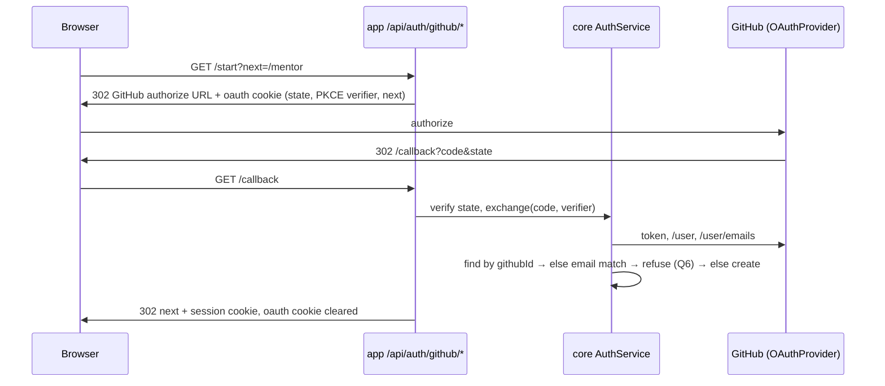
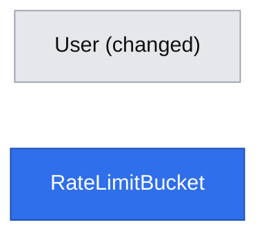

# E01-S01 — Sign in with GitHub or email and password; access by role

- **Date:** 2026-10-31
- **Status:** design complete; all open questions resolved (2026-10-31). Ready for implementation.
- **Issue:** #11 (E01-S01), epic #5 (E01). Depends on: none. Unblocks #12.
- **Builds on:** [platform primitives](2026-10-31-platform-primitives.md), phases PP1 and PP1b, which this story implements.
- **Design authority:** `.ai/specs/product-brief.md` (R06, R07, R35), `AGENTS.md`, `.ai/docs/engineering-standards.md`

## 📝 TLDR

Mentees, mentors and the operator need accounts, and today nobody can sign in: `User` has only `email` and `name`, and no route issues a session.

The plan is for anyone to sign in with GitHub (an account is created on first sign-in), or register and sign in with email and password as the fallback (R06). Everyone is a mentee. The `mentor` role is granted only through an invitation (the grant flow ships in #12), and the `operator` role through a CLI script. Mentor screens refuse non-mentors (R07), and operator screens and `/api/users` refuse non-operators (R35).

## Resolved at the gate (2026-10-31)

| # | Decision |
|---|---|
| Q1 | Primitives are designed in the primitives spec and built with their first consumer. This story builds PP1. |
| Q2 | Amend the standards: fixed roles `mentee`, `mentor`, `operator` with code-level policies, and no RBAC tables. |
| Q3 | A user holds a set of roles. `mentee` is always present, and `mentor` and `operator` are added on top. |
| Q4 | The first operator is granted by CLI: `npm run operator:grant -- <email>`. Review hardening: it grants only to an account with a linked GitHub identity (`githubId` and `emailVerifiedAt` set). An unverified password account could belong to anyone who typed that email. |
| Q5 | Our own authorization-code flow with `state` and PKCE, behind an `OAuthProvider` port with a GitHub adapter. No new dependency. |
| Q6 | If the GitHub email matches an account that is already linked or verified, refuse. Q12 narrows this: an unverified, unlinked account is taken over instead of refused. The account page still offers „Połącz konto GitHub” for password users who want both sign-in methods. |
| Q7 | No email verification in 1.0. `emailVerifiedAt` is set only from a GitHub-verified email. #12 redeems invitations by single-use link, never by email match. |
| Q8 | The JWT carries `sub` + `sv` (session version). Roles and the version are loaded from the database on every request. |
| Q9 | `(auth)`, `(mentee)`, `(mentor)` and `backend` use shadcn. `(marketing)` stays plain Tailwind. |
| Q10 | Two specs: this one and the primitives spec. |
| Q11 | Registering with an email that already has an account answers 409 „Konto z tym adresem już istnieje. Zaloguj się.” This disclosure is accepted, with per-IP and per-email rate limits on register, until verification email lands with the notification port (#23). `engineering-standards.md` ("Auth error messages") records it as a known limitation. Login errors stay generic. |
| Q12 | A GitHub-verified email takes precedence over an **unverified, unlinked** password account. On first GitHub sign-in the account's `password_hash` is cleared, its `session_version` is bumped (every existing session ends), and the GitHub identity is linked with `emailVerifiedAt` set. This is logged without the email, and the user lands on `/account?notice=github_linked` with the text „Połączyliśmy konto z GitHub. Hasło ustawione wcześniej dla tego adresu zostało usunięte.” Raised by the review as the standard defence against account pre-hijacking. |

## 📝 Problem Statement

Mentees and mentors need an account. GitHub is the chosen sign-in because "my GitHub is my profile" (D07/R06). Email and password cover people without GitHub. Mentors join only by invitation (R07), and the operator works through screens (R35), so role checks must exist before any mentor or operator screen is built (#12–#15).

Evidence note: `research/D07-login.md` in this repository contains a sources readme, not the D07 record (see lesson `2026-10-26-research-files-not-trustworthy-by-name`). R06 in the product brief is the authority used here.

## 📝 Proposed Solution

Every route uses `apiRoute` / `respond` / `redirectTo` from PP1. No route writes a cookie or a redirect by hand.

Alternatives that lost (see the primitives spec):
- **Auth.js / `arctic`:** we write our own code instead (Q5).
- **Roles in the JWT:** roles are read from the database (Q8).
- **Automatic account linking:** refused, because it allows account pre-hijacking (Q6).

## 📝 Architecture

New or changed files. "PP1" marks a platform primitive built here; it is specified in the primitives spec.

| Package | File | Responsibility |
|---|---|---|
| db | `entities/auth/user.entity.ts` | new columns (Data Model) |
| db | `entities/platform/rate-limit-bucket.entity.ts` | PP1 / P6 |
| core | `http/access.ts`, `http/api-route.ts`, `http/respond.ts`, `http/errors.ts` | PP1 / P1 |
| core | `services/platform/{clock,policy,rate-limit.service}.ts` | PP1 / P2, P5, P6 |
| core | `services/auth/session.service.ts` | `issue`, `resolve` (P1 contract) and `revokeAll(userId)` (bumps `sessionVersion`) |
| core | `services/auth/auth.service.ts` | `register`, `signInWithPassword`, `signInWithGitHub`, `linkGitHub`, `signOut` |
| core | `services/auth/password-hasher.ts` | `bcryptjs`, cost 12, plus a constant dummy hash so unknown emails take the same time |
| core | `services/auth/oauth-provider.port.ts` | `authorizationUrl({ state, codeChallenge, redirectUri })`, `exchange({ code, codeVerifier, redirectUri }) → ExternalIdentity` |
| core | `services/auth/adapters/github-oauth-provider.ts` | token endpoint, `GET /user`, `GET /user/emails` (primary and verified only); base URLs from env |
| core | `services/auth/adapters/in-memory-oauth-provider.ts` | unit and integration tests |
| core | `services/auth/oauth-state.ts` | signed short-lived state cookie: JWT `{ aud: "oauth-state", state, verifier, next, intent, linkUserId? }`, 10 min |
| core | `services/auth/user.service.ts` | adds `findByEmail`, `grantRole(userId, role)`, `revokeRole`; email normalized (trim, lower-case) |
| core | `services/auth/auth.policy.ts` | `canAccessMentorArea`, `canAccessOperatorArea`, `canListUsers` |
| core | `validators/auth/{register,login}.schema.ts` | shared by route and `CrudForm` (P18) |
| core | `config/env.ts` | `APP_URL`, `GITHUB_CLIENT_ID`, `GITHUB_CLIENT_SECRET`, `GITHUB_OAUTH_URL` (default `https://github.com`), `GITHUB_API_URL` (default `https://api.github.com`), `TRUST_PROXY_HOPS` (int, default 0); all optional. `isGitHubConfigured()` requires all of `APP_URL`, `GITHUB_CLIENT_ID` and `GITHUB_CLIENT_SECRET`. |
| core | `logger.ts` | redact adds `password`, `passwordHash`, `code_verifier`, `access_token`, `cookie`, plus `code` on OAuth paths only |
| app | `api/auth/{register,login,logout,me}/route.ts` (`apiRoute`), `api/auth/github/{start,callback}/route.ts` (`browserRoute`: every outcome is a 302, never JSON) | wiring only |
| app | `api/users/route.ts` | `access: { anyRole: ["operator"] }` |
| app | `lib/auth/page-scope.ts` | PP1 / P3 |
| app | `(auth)/{layout,login/page,register/page}.tsx` | sign-in screens |
| app | `(mentee)/{layout,account/page}.tsx` | account page: details, connect GitHub, sign out |
| app | `(mentor)/{layout,mentor/page}.tsx` | mentor area entry, gated; #13–#15 fill it in |
| app | `backend/page.tsx` (+ layout nav) | gated to operator |
| ui | `backend/feedback/AccessDenied.tsx`, `backend/layout/{AppShell,NavLinks}.tsx` | PP1 / P3 |
| ui | `components/auth/{GitHubButton,SignOutButton}.tsx` | concept components used by several pages |
| root | `scripts/operator-grant.ts`, `package.json` script `operator:grant`, `tsx` devDependency | PP1 / P19 |
| test | `support/github-stub.ts`, `support/seed.ts`; `e2e/global-setup.ts` starts the stub and passes `GITHUB_*_URL` | PP1 / P19 |

Dependencies: `bcryptjs` goes into `@devmentor/core` (mandated by the standards), and `tsx` into the root devDependencies. Nothing else.

## 📝 Data Model

`users` (changed):

| Column | Type | Notes |
|---|---|---|
| `email` | `varchar(255)` unique | existing; now always stored trimmed and lower-cased. The migration first fails with a clear message if existing rows differ only by case, then lower-cases them. |
| `name` | `varchar(255)` | existing |
| `password_hash` | `varchar(60)` null | bcrypt; null for GitHub-only accounts |
| `github_id` | `varchar(30)` null, unique | GitHub's numeric user id: the identity key, never the login |
| `github_login` | `varchar(39)` null | display and profile link; refreshed on each GitHub sign-in |
| `roles` | `text[]` not null, default `{mentee}` | check: every element in (`mentee`, `mentor`, `operator`) and `mentee` present |
| `session_version` | `int` not null, default 1 | bumped by `revokeAll` (sign-out, Q12 takeover) |
| `email_verified_at` | `timestamptz` null | set only from a GitHub primary verified email |
| `updated_at` | `timestamptz` not null | `onUpdate` |

`rate_limit_buckets` (new, P6): `key varchar(200)`, `window_start timestamptz`, `count int`, unique `(key, window_start)`.

Migration notes:
- The migration is created with `npm run db:migration:create` and the snapshot is committed with it.
- Existing demo rows get `roles = {mentee}` and no credentials, so they cannot sign in. That is intended: there is no production data yet.
- No DB check enforces "at least one credential", because existing rows would violate it. The service enforces it instead.

Sensitive data:
- `password_hash` is never serialized. A `toMe(user)` mapper returns `{ id, name, email, githubLogin, roles }` only.
- No GitHub access token is stored. It is used once inside `exchange` and then discarded.

`RateLimitBucket` has no relation to `User`: its keys are hashed email or IP strings.

## 📝 API Contracts

Every route returns the envelope. Unsafe methods need `x-devmentor-request: 1` (`apiCall` sends it).

| Route | Access | Input | Success | Errors |
|---|---|---|---|---|
| `POST /api/auth/register` | public (reason: creates the account) | `{ name: 1–100, email, password: 12–72 bytes }` | 201 `Me` + session cookie | 400 field errors, 409 `conflict` with `fieldErrors.email` „Konto z tym adresem już istnieje. Zaloguj się.” (Q11), 429 |
| `POST /api/auth/login` | public (reason: issues the session) | `{ email, password }` | 200 `Me` + session cookie | 401 „Nieprawidłowy e-mail lub hasło.” (same for unknown email, GitHub-only account, wrong password), 429 |
| `POST /api/auth/logout` | public (reason: clearing a cookie is always safe) | — | 200 `null`, cookie cleared; if a valid session was present, `revokeAll` | — |
| `GET /api/auth/me` | session | — | 200 `Me` | 401 |
| `GET /api/auth/github/start` | public (reason: starts OAuth; CSRF is protected by `state`) | `?next=<safe path>&intent=signin\|link` | 302 to GitHub + oauth cookie (`path=/api/auth/github`, httpOnly, lax, 600 s) | 302 `/login?error=github_unavailable` when not configured; `intent=link` without a session → 302 `/login` |
| `GET /api/auth/github/callback` | public (reason: OAuth redirect target; checked by `state` + PKCE) | `?code&state` or `?error` | 302 to `next` (or the role default) + session cookie; oauth cookie cleared | 302 `/login?error=<code>`: `github_denied`, `github_state`, `github_no_verified_email`, `github_account_exists`, `github_already_linked`, `github_failed`; link errors return to `/account?error=` |
| `GET /api/users` | `{ anyRole: ["operator"] }` | — | 200 users (`Me` shape) | 401, 403 |

`Me = { id, name, email, githubLogin: string | null, roles: Role[] }`.

Rules:
- **Password length.** Between 12 characters and 72 bytes. bcrypt silently truncates anything past 72 bytes, so the schema rejects longer input instead.
- **Rate limits.** Named constants, chosen for a small user base:
  - login: 10 *failures* per 15 min per email hash, plus 50 failures per 15 min per IP (`check`/`hit`);
  - register: 5 per hour per IP and 3 per hour per email hash (`consume`);
  - GitHub callback: 30 per 15 min per IP (`consume`);
  - when the IP is unknown (`TRUST_PROXY_HOPS=0`), each per-IP limit becomes a route-wide bucket ×10;
  - a successful login resets the email key;
  - the lockout trade-off is accepted and documented (primitives P6).
- **`next` handling.** `next` always goes through `safeRedirectPath`. Default destinations: operator → `/backend`, mentor → `/mentor`, otherwise `/account`. This is a temporary mentee home until the mentor list (#16) exists.
- **Redirect URI.** Built from `APP_URL`, never from the `Host` header.
- **GitHub scope.** `read:user user:email`.
- **Session cookie.** Unchanged: `devmentor_session`, httpOnly, secure in production, lax, 24 h. The JWT is `{ aud: "session", sub, sv }`, signed HS256 with `AUTH_SECRET`.
- **Callback re-check.** The callback runs `next` from the state cookie through `safeRedirectPath` again before redirecting.

`signInWithGitHub(identity)`:
1. Find a user by `githubId`. If found, refresh `githubLogin` and sign in.
2. Otherwise, if `identity.email` is null (no primary verified email), refuse with `github_no_verified_email`.
3. Otherwise, find a user by `email`.
   - No user: go to step 4.
   - A user with neither `githubId` nor `emailVerifiedAt`: take it over (Q12). In one transaction, clear `password_hash`, set `githubId`, `githubLogin` and `emailVerifiedAt`, and bump `session_version`. Then sign in and redirect to `/account?notice=github_linked`.
   - Otherwise: refuse with `github_account_exists` (Q6). In 1.0 this means the email belongs to an account linked to a *different* GitHub identity.
4. Otherwise, create a user with `{ email, name: identity.name ?? identity.login, githubId, githubLogin, emailVerifiedAt: clock.now(), roles: ["mentee"] }`. A unique-constraint violation from a concurrent first sign-in maps to `github_failed`, and signing in again succeeds through step 1.

`linkGitHub(actor, identity)`:
- If `githubId` already belongs to another user, refuse with `github_already_linked`.
- Otherwise set `githubId` and `githubLogin`. If the GitHub verified email equals the account email, also set `emailVerifiedAt`.
- The link flow carries `linkUserId` in the signed state cookie, and the callback also requires the current session to match it.

## 📝 UI/UX

All copy is in Polish.

**`/login`**
- Primary button „Zaloguj się przez GitHub”.
- Separator „lub”.
- `CrudForm` with fields „E-mail” and „Hasło”, submitting „Zaloguj się”.
- Link „Nie masz konta? Załóż konto”.
- `?error=` is mapped to messages, for example `github_account_exists` → „Ten adres e-mail należy do konta połączonego z innym kontem GitHub.”
- A signed-in visitor is redirected to their default destination.

**`/register`**
- The same GitHub button.
- Fields „Imię i nazwisko”, „E-mail” and „Hasło” (hint: „Co najmniej 12 znaków.”), submitting „Załóż konto”.

**After a form succeeds**
- `window.location.assign(next)`: a full navigation, so server components see the cookie.

**`/account`** (any signed-in user)
- Name, email and roles shown as badges.
- GitHub: either „Połączono z GitHub: @login” or the button „Połącz konto GitHub”.
- „Wyloguj się”.

**`/mentor`**
- The heading „Panel mentora” and the line „Tu pojawią się Twój profil, ceny i terminy.”
- Non-mentors get `AccessDenied`: „Nie masz dostępu do tej strony.”, with the explanation „Mentorzy dołączają tylko z zaproszenia.” (R07).

**`/backend`**
- Gated to the operator. Others see `AccessDenied`.

**Navigation**
- Navigation in `AppShell` is built from roles: „Konto”, plus „Panel mentora” for mentors and „Panel operatora” for the operator.
- The marketing home page gets a plain Tailwind link „Zaloguj się”.

**States and accessibility**
- Loading uses `CrudForm`'s submit state.
- The GitHub button is a real link (`<a>`), so it works without JavaScript.
- Errors appear in an `aria-live` region (`ErrorMessage`).
- Every input has a label.

## 📝 Edge Cases & Failure Scenarios

| Scenario | What the user sees / what happens |
|---|---|
| GitHub env not configured | GitHub buttons are hidden (the page checks a `isGitHubConfigured()` flag from core) and `/start` redirects with `github_unavailable`. Password sign-in still works. |
| GitHub is down or the token exchange fails | 302 `/login?error=github_failed` („Nie udało się zalogować przez GitHub. Spróbuj ponownie.”). The failure is logged without the code or token. |
| User cancels on GitHub (`?error=access_denied`) | `github_denied`: „Logowanie przez GitHub zostało anulowane.” |
| Missing or expired oauth cookie, or `state` mismatch | `github_state`: „Sesja logowania wygasła. Spróbuj ponownie.” Compared in constant time. |
| GitHub account without a verified primary email | `github_no_verified_email`: the user is asked to verify the email on GitHub or to register with a password. |
| GitHub user changes their login | The identity key is `github_id`, so `github_login` is simply refreshed. |
| Role granted or revoked while signed in | It applies on the next request (Q8). |
| Signed out on one device | `revokeAll` bumps `sv`, so other devices are signed out too. The account page says so under the button: „Wylogujemy Cię na wszystkich urządzeniach.” |
| `AUTH_SECRET` missing | Sign-in routes return 500 („Coś poszło nie tak…”). Pages fail closed. |
| Rate limited | 429 with „Zbyt wiele prób. Spróbuj ponownie za kilka minut.”, shown in the form error. |
| Two tabs both complete a first GitHub sign-in | The unique `github_id` lets one win. The other gets `github_failed`, and retrying signs in. |
| Open redirect attempt (`next=//evil.com`) | `safeRedirectPath` falls back to the default destination. |

## 📝 Risks & Impact Review

- **`risk-high` (auth).** Review the following deeply: state and PKCE handling, the cookie attributes, the generic login error, `safeRedirectPath`, constant-time compare, and the redact list.
- **Public `core` API change** (`Session` → `Actor`). See the primitives spec. The only consumer is `/api/users`.
- **Behaviour change.** `/api/users` and `/backend` are no longer public. The `/backend` demo now needs an operator, which is granted with `npm run operator:grant`. The README setup section gains that step.
- **Account enumeration** on register is accepted (Q11), bounded by the register rate limits, and recorded in the standards as a known limitation until email verification exists.
- **Q12 takeover is irreversible.** It deletes a password the squatter or the real owner set. That is intended, because an unverified password account carries no proof of ownership. It is covered by unit and E2E tests and logged.
- **Operator bootstrap ordering.** `operator:grant` needs a GitHub-linked account, so in a real environment the first operator can be granted only once Phase 3 ships. Tests seed linked accounts directly. #11 is released as a whole, so the user never sees this gap.
- **No email verification.** A password account can claim any email. Mitigations:
  - invitations by link (#12);
  - `emailVerifiedAt` stays null;
  - GitHub sign-in refuses to auto-link (Q6).
- **Rollback.** The migration's `down` drops the new columns and table. The roles column is the only data that would be lost, and it can be restored by re-running `operator:grant`.

## 📝 Decisions in play

- **R06** (GitHub for every role, email and password as fallback): implemented.
- **R07** (mentors by invitation only): enforced as a gate. The grant flow is #12.
- **R35** (operator works through screens): the gate on `/backend`.
- **D07:** cited through R06. Its record in this repo is mismatched (see Problem Statement).
- No product decision is superseded. The engineering-standards amendments (roles, Q2; register disclosure, Q11) are standards changes the user approved on 2026-10-31.

## 📋 Phasing

1. **Phase 1, platform PP1 and the session foundation.** Primitives from the primitives spec, the `User` columns and migration, `SessionService`, the operator CLI, and gating `/api/users` and `/backend` to the operator. User-visible change: `/backend` needs an operator (granted by CLI to a seeded, linked account in tests).
2. **Phase 2, email and password accounts.** Register/login/logout/me, pages and the mentor gate. Shippable alone: it covers R06's fallback, R07 and R35.
3. **Phase 3, GitHub sign-in and linking.** Port, adapter, start/callback, account linking, GitHub stub for E2E.

## 📋 Implementation Plan

Every step keeps `lint`, `typecheck`, unit tests (100%), integration tests and the build green. Every phase ends with the full gate, including `npm run test:e2e`.

**Phase 1 — PP1 and the session foundation**

1–7. Steps 1–7 exactly as listed in the [primitives spec](2026-10-31-platform-primitives.md#📋-implementation-plan). Step 7 covers the amendments to the standards (roles, Q2; the register-disclosure limitation, Q11), AGENTS.md, ESLint and vitest coverage, including the `(student)` → `(mentee)` rename.

8. `User` entity columns and the migration, with the snapshot committed. Integration tests cover:
   - the migration on an empty DB;
   - the unique `github_id`;
   - the `roles` check rejecting `{mentor}` without `mentee`;
   - lower-casing of existing emails;
   - the case-duplicate guard.
9. `SessionService` and `UserService.grantRole` / `revokeRole` / `findByEmail`.
   - Unit tests for `issue` claims (`aud`, `sv`), and for `resolve` with a bad signature, a wrong `aud`, an expired token, an unknown user and a stale `sv`.
   - Unit tests that roles come from the DB.
   - Integration tests for the grants.
10. `scripts/operator-grant.ts`, the `operator:grant` script and the README setup step. Unit tests for `main` cover:
    - an unknown email: exit 1, Polish message;
    - an unverified or unlinked account: refused, with the reason;
    - a linked account: role granted and logged;
    - an already-operator account: no-op.
11. `auth.policy.ts` (`canListUsers`, `canAccessOperatorArea`).
    - `/api/users` moves to `{ anyRole: ["operator"] }`; unit tests cover 401 when anonymous and 403 for a mentee.
    - `/backend` is gated with `pageScope` and rendered inside `AppShell`.
    - `test/support/seed.ts` gets `seedUser` and `signInAs` through core services.
    - The existing `test/e2e/app.e2e.test.ts` `/backend` scenarios are rewritten to sign in as a seeded, linked operator, and a new scenario checks that an anonymous visitor is redirected to `/login`. Until Phase 2, that page is a minimal placeholder.

**Phase 2 — email and password**

12. `PasswordHasher`, `validators/auth`, and `AuthService.register` / `signInWithPassword` / `signOut`. Unit tests cover:
    - the timing path for an unknown email;
    - a GitHub-only account;
    - `check`/`hit`/`consume` calls;
    - the duplicate email returning the Q11 409 with `fieldErrors.email`.
13. Routes `register`, `login`, `logout` and `me` on `apiRoute`. Unit tests cover:
    - cookie attributes;
    - the CSRF header requirement;
    - envelope errors;
    - 429 with `Retry-After`.
14. Pages `(auth)/login` and `(auth)/register` with `CrudForm`, `(mentee)/account`, and `(mentor)/mentor` gated by `canAccessMentorArea`, plus `navFor`. jsdom tests cover every page state and the error-code-to-message mapping.
15. E2E (`test/e2e/auth.e2e.test.ts`), checking `pageErrors()` is empty in each scenario:
    - register → land on `/account` → sign out → sign in again;
    - a mentee opens `/mentor` and `/backend` → `AccessDenied`;
    - a seeded mentor opens `/mentor` → allowed.

**Phase 3 — GitHub**

16. `OAuthProvider` port, the in-memory adapter and the GitHub adapter. Unit tests stub `fetch` and cover:
    - the authorize URL (scope, PKCE S256, state);
    - token error handling;
    - choosing the primary verified email;
    - a missing email.
17. `oauth-state.ts` and `AuthService.signInWithGitHub` / `linkGitHub`.
    - `oauth-state.ts` is a signed cookie with `aud: "oauth-state"` and a 10-minute expiry.
    - Unit tests cover every branch in API Contracts, including the Q12 takeover (password cleared, `sv` bumped, an old session refused afterwards) and the refusal for a differently linked account.
    - An integration test covers concurrent first sign-ins under the unique `github_id`.
18. Routes `github/start` and `github/callback` on `browserRoute`, plus `isGitHubConfigured()`. Unit tests cover:
    - not configured, or `APP_URL` missing;
    - `access_denied`;
    - a state mismatch;
    - a link intent without a session;
    - `next` checked again at the callback;
    - a DB error or 429 still answering with a 302.
19. GitHub buttons on `/login`, `/register` and `/account` (connect), and the error mapping, with jsdom tests.
20. `test/support/github-stub.ts`: a node `http` server for authorize, token, `/user` and `/user/emails`.
    - `e2e/global-setup.ts` starts it and passes `GITHUB_OAUTH_URL`, `GITHUB_API_URL`, the client id and secret, and `APP_URL` to `next start`.
    - E2E: a first GitHub sign-in creates the account, a second sign-in reuses it, an unverified password account with the same email is taken over (the old password no longer works, and the notice is shown), and GitHub can be connected from `/account`.
21. Full gate: `npm run lint`, `npm run typecheck`, `npm run test:unit`, `npm run test:integration`, `NODE_ENV=production npm run build`, `npm run test:e2e`. Then a manual browser check of `/login`, `/register`, `/account`, `/mentor` and `/backend`.
