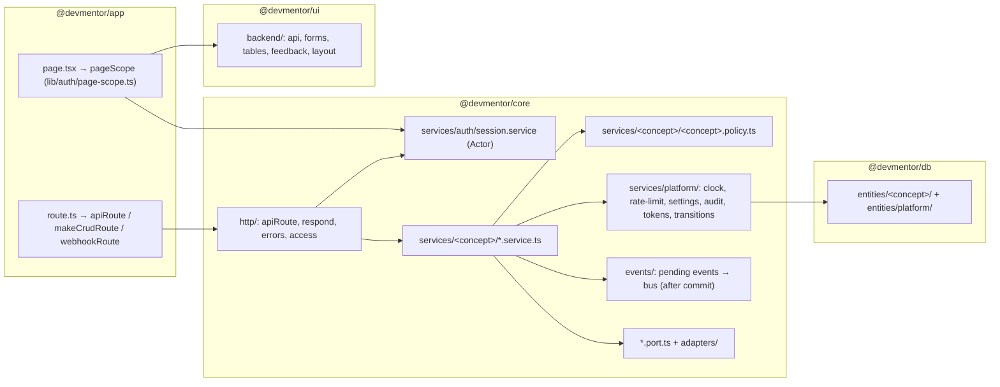
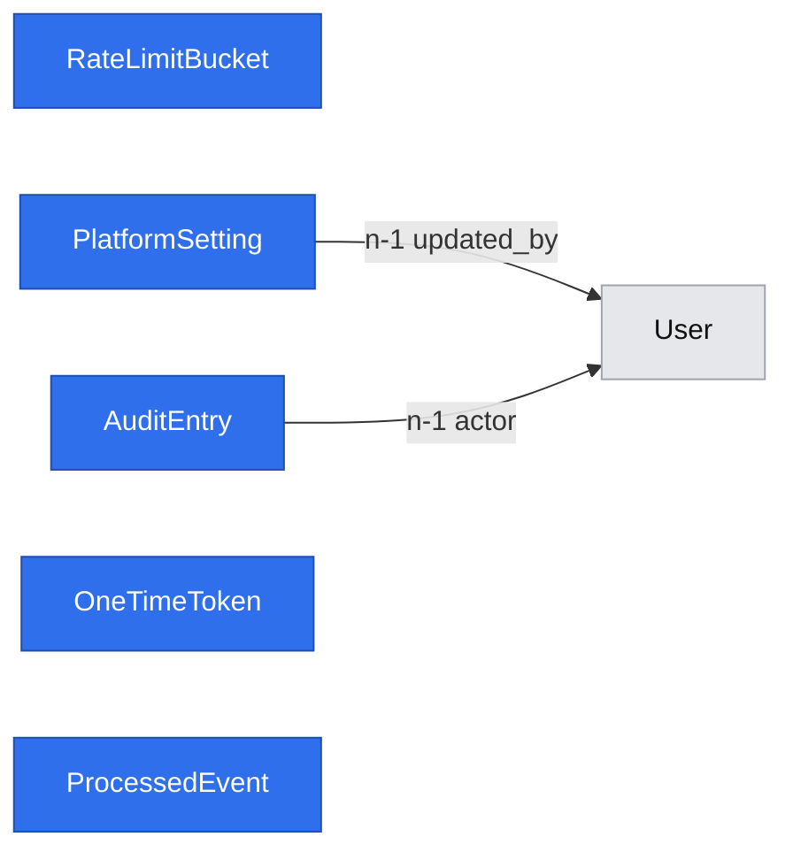

# Platform primitives for DevMentor 1.0

- **Date:** 2026-10-31
- **Status:** design accepted at the gate; review corrections applied with user authorization (2026-10-31). Built incrementally: each primitive is implemented by the first story that consumes it (see Phasing). The spec moves to `implemented/` when the last phase ships.
- **Design authority:** `AGENTS.md`, `.ai/docs/engineering-standards.md`, `.ai/specs/product-brief.md`
- **First consumer:** [E01-S01 accounts and role access](2026-10-31-e01-s01-accounts-and-role-access.md) (#11)

## 📝 TLDR

The 1.0 backlog (#11–#24) has 13 stories across five epics. They keep needing the same mechanisms: knowing who is acting and under which role, checking a record belongs to a party, talking to a vendor (GitHub, Stripe, notifications), PLN money and fees, operator-set settings that gate features, status lifecycles, deduplicated webhook processing, side effects after a change, audit of operator actions, single-use links, paginated lists, and screens that refresh while open.

This spec defines shared contracts and their package locations. A consuming story ratifies or amends future contracts when its concrete requirements are known; the catalogue is not a requirement to build a framework in advance. It extends the existing `core/src/http` and `ui/src/backend` layers and stays inside the four-package architecture. S01 adds `bcryptjs` (already mandated by the standards) and the root `tsx` development tool.

Decisions taken at the gate (2026-10-31):
- the catalogue is designed here, and each primitive is built with its first consumer (YAGNI);
- fixed roles are checked in code, with no RBAC tables;
- a user holds a *set* of roles;
- roles are read from the database on each request;
- signed-in screens use shadcn;
- this spec is kept separate from the S01 feature spec.

## 📝 Problem Statement

What exists (verified 2026-10-31):
- `apiHandler(request, context)` provides CSRF checking, the response envelope and logging. It knows nothing about who the caller is and has no DI scope.
- `makeCrudRoute` offers `access: "public" | "session"` only.
- `auth.ts` has `requireSession` / `requireRole` / `assertOwnership` with roles `"student" | "mentor"`.
- `ui/src/backend` has `apiCall`, `useApiResource`, `CrudForm` (text, email, password, number, url fields), `DataTable` (client-side pagination only) and feedback components.
- There are no ports, events, validators, settings, money type, clock, page guard, or cookie/redirect responses.

How the backlog maps onto mechanisms:

| Backlog need | Stories | Primitive |
|---|---|---|
| Caller identity and roles, on routes and on pages | all | P1 Actor, P3 page access |
| Role gates, "is a party to this record", "operator sees sessions" | #11, #12, #13–#15, #18–#20 | P2 policies |
| Routes that set cookies, redirect, take query/params/body, run in one scope | all | P1 `apiRoute` |
| GitHub OAuth, Stripe Checkout/Connect, notifications | #11, #22, #23, #24 | P4 ports and adapters |
| 2-hour lead time, payout hold window, booking-to-start, token expiry | #11, #15, #17, #21 | P5 clock |
| Brute-force limits | #11, #12 | P6 rate limiter |
| PLN prices, bounds, fee, payout = price − fee | #14, #17, #18, #21 | P7 money |
| Operator-set fee/bounds/terms that block features until set (R28, R29, R33) | #14, #17 | P8 platform settings |
| Invitation, booking, payment, payout, note lifecycles | #12, #17, #18, #20, #21 | P9 state transitions |
| Notify both parties, record booking-to-start | #17, #18, #19 | P10 domain events |
| Stripe webhook deduplication and atomic local effects | #17, #21, #24 | P11 webhook inbox |
| Operator actions on access and money (R35) | #12, #14, #21 | P12 audit log |
| Invitation links | #12 | P13 one-time tokens |
| Filtered public list, operator tables, "my bookings" | #12, #16, #18 | P14 list queries |
| Text session and co-edited note | #19, #20 | P15 live resource and edit conflicts |
| Slot times shown to people in different time zones | #15, #16, #17 | P16 time display |
| Persona shells and navigation | all screens | P3 shells |
| Payouts released after a hold window, with no workers (AGENTS.md) | #21 | P17 due work (decision deferred) |

## 📝 Proposed Solution

Grow the two shared layers that already exist (`core/src/http`, `ui/src/backend`) and add a `platform` concept folder for cross-cutting persistence. No module loader, no base service class, and no fifth package.

Alternatives that lost:
- **A generic RBAC/permission table:** the standards exclude it, and three fixed roles with code-level policies are greppable and testable.
- **Auth.js / NextAuth:** it brings its own session and adapter model, which conflicts with the mandated jose JWT and MikroORM.
- **A queue for events and payouts:** AGENTS.md says the project has no queues or workers.
- **WebSockets for the session screen:** this needs a long-lived server, which is unnecessary at 1.0 volumes. Polling covers 25/50-minute text sessions.
- **`next/navigation` `forbidden()` for page denial:** it is experimental (needs `experimental.authInterrupts`) and cannot be called in a root layout, and every persona group here *is* a root layout. A stable `AccessDenied` render is used instead.

## 📝 Architecture



Every request and every render opens **one** main scope. Inside it, the actor is resolved, input is parsed, and the service runs. A mutating workflow owns its outer transaction; reads do not open one unnecessarily. P6's independent counter writes and P10's subscriber scopes are explicit exceptions. Pages and routes share `Access`/`hasRole`; record-level policies live in services. Event collection and dispatch are added only with P10 and are tied to the actual outer commit, not to the lifetime of the HTTP request.

### P1 — Actor, route builder, responses (`core/src/http`, `core/src/services/auth`)

```ts
// http/access.ts
export const ROLES = ["mentee", "mentor", "operator"] as const;
export type Role = (typeof ROLES)[number];
export interface Actor { readonly userId: string; readonly roles: ReadonlySet<Role>; readonly sessionVersion: number }
export type Access = "public" | "session" | { anyRole: readonly [Role, ...Role[]] };
export function hasRole(actor: Actor, role: Role): boolean;

// services/auth/session.service.ts (scoped: em, clock)
class SessionService {
  issue(user: User, authTime?: Date): Promise<string>; // JWT {sub, sv: user.sessionVersion, auth_time: authTime ?? now}, 24 h
  resolve(token: string | undefined): Promise<ResolvedSession>; // verify + load user + compare sv; else UnauthorizedError
  renewal(session: ResolvedSession): Promise<CookieSpec | null>; // sliding renewal, see below
}
interface ResolvedSession { actor: Actor; expiresAt: Date; authTime: Date }

// http/api-route.ts
interface RouteCtx<A extends Access> {
  cradle: Cradle; request: Request;
  clientIp: string | null;                          // see P6; null unless TRUST_PROXY_HOPS > 0
  actor: A extends "public" ? Actor | null : Actor; // public routes still see an optional actor
}
export function apiRoute<A extends Access, P, Q, B, T>(config: {
  access: A;
  params?: ZodType<P>; query?: ZodType<Q>; body?: ZodType<B>;
  status?: number;
  run(ctx: RouteCtx<A>, input: { params: P; query: Q; body: B }): Promise<T | HttpResult<T>>;
}): RouteHandler;

// http/respond.ts — the only way a route sets cookies or redirects
export function respond<T>(data: T, init?: { status?: number; cookies?: CookieSpec[] }): HttpResult<T>;
export function redirectTo(path: SafePath, init?: { cookies?: CookieSpec[] }): HttpResult<never>;
export function redirectToProvider(url: TrustedProviderUrl, init?: { cookies?: CookieSpec[] }): HttpResult<never>;
export function safeRedirectPath(input: unknown, fallback: SafePath): SafePath;
// accepts "/" or "/" + a non-"/" char; rejects backslashes and any control char (browsers strip \t\r\n, so "/\t/evil" would become "//evil")

// http/browser-route.ts — for top-level browser navigations (OAuth start/callback, later Stripe return URLs)
export function browserRoute<A extends Access>(config: Omit<ApiRouteConfig<A>, "status"> & {
  errorRedirect: SafePath | ((error: unknown) => SafePath); // default "/login"; trusted link-flow errors may use "/account"
  errorCode(error: unknown): string;                // AppError → its mapped code; anything else → a generic code (logged)
  errorCookies?: CookieSpec[];                      // e.g. expire the OAuth flow cookie even when execution fails
}): RouteHandler;                                   // never answers JSON: every outcome is a 302
```

- **Order per request.** CSRF header check for unsafe methods (unchanged), then open one scope, then resolve the actor, then the role gate, then parse params/query/body, then `run`, then dispose the scope. Public access maps absent/invalid sessions to `null`; infrastructure and configuration errors still propagate rather than masquerading as anonymous access. PP1 has no event collector, dispatcher or placeholder registrations. P10 later adds commit-bound dispatch inside its workflow execution boundary.
- **Redirect destinations.** `SafePath` is exclusively for local destinations, including user-supplied `next`. `TrustedProviderUrl` is constructed by the OAuth adapter from its configured authorization endpoint and generated parameters; validation requires that exact origin and pathname, no URL credentials or fragments, and HTTPS except explicitly configured loopback HTTP for local tests. Request parameters never choose the provider origin. `redirectToProvider` serializes that validated destination; it does not accept arbitrary strings. The localhost E2E stub exercises this same validation.
- **Session renewal (sliding, capped).** Decided while grilling the spec (2026-10-31). Each token is still valid for 24 h. When `apiRoute` or `browserRoute` resolves a valid session token with less than 12 h left, the response re-issues a fresh 24 h token with the same `sv` and the original `auth_time`. Renewal stops once `auth_time + 7 d` has passed, so a stolen cookie cannot be kept alive indefinitely by polling; logout (`sv` bump) still ends it immediately. A stale `sv` is never renewed, and a route that sets its own session cookie (sign-in, sign-out) takes precedence over renewal. Pages cannot set cookies, so renewal happens on `/api/*` calls; signed-in screens call them anyway (`useApiResource`, P15 polling). Named constants: `SESSION_TTL` 24 h, `SESSION_RENEW_BELOW` 12 h, `SESSION_ABSOLUTE_MAX` 7 d.
- **JWT audiences.** Every token signed with `AUTH_SECRET` carries an `aud` claim (`"session"`, `"oauth-state"`, …), and verification requires it, so one kind of token can never be replayed as another.
- **Session version.** `Actor.sessionVersion` is the verified JWT `sv`, checked against the loaded user. It is internal authentication context, not part of `Me`. Linking captures it in signed OAuth state and rechecks it under the user-row lock before mutation. Never replace it with a newer database version to make a stale session valid.
- **Browser errors.** `errorCode` maps only to an allowlist of public codes. Dynamic error destinations may use trusted flow metadata only after OAuth state has been verified; otherwise they fall back to `/login`. For the callback, configure `errorCookies` to expire the OAuth cookie for failures occurring before `run` as well as inside it. Error mapping/serialization must be total, with a fixed safe generic redirect if a mapper itself fails.
- **Builders.** Refactor `apiHandler` internals to share execution, CSRF, error classification and safe logging with `apiRoute` and `browserRoute`. JSON and browser response adapters select the final representation: JSON routes serialize data/`respond` results and map errors to envelopes; browser routes serialize only redirect results and map every error to a local 302 with an allowlisted error code. Do not wrap a JSON-catching handler inside a browser handler or serialize an `HttpResult` as ordinary data. Cookie clearing on OAuth errors is part of the browser adapter's response contract. `makeCrudRoute` is rebuilt on `apiRoute`; `access` widens to `Access`, and `CrudContext.session` is replaced by `actor`. This is a coordinated breaking internal API change under `BACKWARD_COMPATIBILITY.md`, with all callers migrated in the same PR.
- **Removed or replaced.** `Session`, `requireSession`, `requireRole` and `createSessionToken` are removed from the public `core` API and replaced by `Actor`, `SessionService` and `Access`. `assertOwnership` moves into P2.
- **New `AppError`s.**

  | Error | Status | Code | Notes |
  |---|---|---|---|
  | `TooManyRequestsError` | 429 | `rate_limited` | sets `Retry-After` |
  | `ServiceUnavailableError` | 503 | `service_unavailable` | an optional integration is not configured |
  | `PreconditionError` | 409 | `precondition_failed` | an operator setting is missing (R28/R29/R33) |
  | `InvalidTransitionError` | 409 | `invalid_transition` | |
  | `StaleVersionError` | 409 | `stale_version` | |

  All carry Polish messages. PP1 adds only `TooManyRequestsError` and `ServiceUnavailableError`; the other classes ship with their first actual consumers (settings, lifecycle transitions, concurrent editing).

### P2 — Policies (`core/src/services/<concept>/<concept>.policy.ts`)

- **Form.** Pure functions `can<Action>(actor, record?) => boolean`, with no I/O. A service calls `authorize(canX(actor, record))`, which throws `ForbiddenError` when the check returns `false`. A policy that throws becomes a 500, never an allow.
- **Where checks live.** Route-level `access` covers role gates. Every record-level decision lives in the service, which receives `actor` as its first argument. A route never decides about a record.
- **No duplicate role policies.** S01 pages and routes use the same `Access` role gate, and navigation uses `hasRole`; do not add `canListUsers`/`canAccessOperatorArea` wrappers that repeat the same role membership rule. Add concept policies when there is a record-level or genuinely distinct business decision.
- **Shared predicates** in `services/platform/policy.ts`:
  - `isParty(actor, { menteeId, mentorId })` (bookings, sessions, notes);
  - `isOwner(actor, ownerId)`, replacing `assertOwnership`;
  - `isOperator(actor)`.
- These predicates are a catalogue, not PP1 deliverables. Preserve/migrate the existing ownership assertion's behavior when replacing its public export; introduce `isParty` and additional wrappers only with a real consumer.
- **Visibility rules** from the brief glossary, encoded once:
  - session: the parties plus the operator;
  - written answer: mentor and mentee only;
  - note: the parties only (R26).
  - The operator is **not** included for the written answer or the note.

### P3 — Page access and persona shells (`app/src/lib/auth/`, `ui/src/backend/layout`, `ui/src/backend/feedback`)

```ts
// app/src/lib/auth/page-scope.ts — reads cookies() from next/headers, then delegates to core
export async function pageScope<T>(
  options: { access: Access; policy?: (actor: Actor) => boolean; nextPath: string },
  load: (ctx: { cradle: Cradle; actor: Actor | null }) => Promise<T>,
): Promise<{ ok: true; actor: Actor | null; value: T } | { ok: false }>;
```

- **One scope per render.** `pageScope` resolves the actor and runs `load` in the same scope, and it never dispatches events, because renders do not mutate.
  - Unauthenticated on a non-public page → `redirect("/login?next=" + safe(nextPath))` (stable Next API).
  - Wrong role or policy → `{ ok: false }`, and the page renders `<AccessDenied />` (copy: „Nie masz dostępu do tej strony.”).
- **Each page checks itself.** Every guarded `page.tsx` calls `pageScope`. The check is not done in a layout, because group layouts are root layouts, and layouts are not re-run on client-side navigation (Next auth guide). Data APIs check again (defence in depth).
- **No `proxy.ts`.** An optimistic redirect there would add a second source of truth for no security gain.
- **Shells are rendered by the page, not the layout.**
  - `ui/src/backend/layout/AppShell.tsx` and `NavLinks.tsx` take `items: { href, label }[]`.
  - The page passes `navFor(actor)` (`app/src/lib/auth/nav.ts`), computed from the actor that `pageScope` already resolved. `ui` must not know about core roles.
  - Persona root layouts (`(auth)`, `(mentee)`, `(mentor)`, `backend`) only set `<html lang="pl">`, the stylesheet and `<body>`. Resolving the actor in a layout would need a second scope, because layouts and pages render in parallel.

### P4 — Ports and adapters (`core/src/services/<concept>/<name>.port.ts`, `…/adapters/`)

- **Files.** One interface per external capability, plus one in-memory adapter (for tests and dev) and one real adapter.
- **Container wiring.** `container.ts` picks the adapter with one explicit factory line, based on `env`.
- **Configuration.** Each real adapter takes its vendor base URL from env (default: the vendor's URL). E2E points it at a local stub server, so the *real* adapter is exercised without network calls to the vendor.
- **Production guard.** The in-memory `PaymentGateway` factory throws `ServiceUnavailableError` on every call when `NODE_ENV=production`. `getEnv()` is lazy and there is no startup hook, so this check runs per request rather than at boot.
- **Optional integrations.** When a vendor is not configured, the feature is degraded rather than crashing the app: its env vars are optional, and the feature throws `ServiceUnavailableError` and is hidden in the UI. The app keeps building and booting without them (AGENTS.md).
- **Planned ports.**

  | Port | First consumer |
  |---|---|
  | `OAuthProvider` | #11 |
  | `PaymentGateway` (Checkout and Connect) | #22, #24 |
  | `Notifier` | #23 |

### P5 — Clock (`core/src/services/platform/clock.ts`)

- **Contract.** `interface Clock { now(): Date }`, registered as `clock: asValue(systemClock)`.
- **Rule.** Every time rule (JWT expiry, rate windows, the 2-hour lead time in R14, hold windows in R30, booking-to-start in R15) reads `clock.now()`. `new Date()` inside services is a review blocker.
- **Tests.** Tests construct services with `{ clock: { now: () => fixed } }`.

### P6 — Rate limiter (`core/src/services/platform/rate-limit.service.ts`, entity `RateLimitBucket`)

- **Contract.** `consume(key, { limit, windowSeconds })` atomically counts an attempt and throws `TooManyRequestsError` when the returned count exceeds the limit. Login, register and OAuth callback use this one operation. There is no separate `check`/`hit`, reset-on-success or refund protocol.
- **Storage.** A fixed window held in Postgres. One atomic `INSERT … ON CONFLICT (key, window_start) DO UPDATE SET count = count + 1 RETURNING count`, written with the query builder and bound parameters, never interpolated. This works across instances, with no Redis.
- **Keys.** Prefix keys with the route/policy and dimension (IP, email, or the (email, IP) pair), so limits for different actions cannot collide. Normalize email before hashing (`sha256`); no plaintext email is stored.
- **Admission order.** Consume the IP (or route-wide fallback) bucket first, then any (email, IP) pair bucket, then the normalized email bucket where applicable, before hashing passwords or calling a provider. If either rejects, do no credential work. Earlier increments remain consumed if a later bucket rejects; this conservative behavior avoids multi-key reservation/refund machinery. Successful and failed attempts both count until window expiry.
- **Separate commit.** Bucket writes run on their own forked `em` and commit on their own, outside any service transaction. Otherwise a login that throws would roll back its own increment. An integration test covers this.
- **Client IP.** `ctx.clientIp` comes from `x-forwarded-for` only when `TRUST_PROXY_HOPS` (an integer, default 0) is greater than 0. In that case it takes the entry at index `length − TRUST_PROXY_HOPS` counted from the **right**, because the leftmost entries are set by the client.
- **IP unknown.** When `clientIp` is `null`, callers use a route-wide global bucket in place of the per-IP bucket. A route never runs without some limit.
- **Lockout trade-off.** Counting all attempts can block even a correct password after the limit, including after repeated successful sign-ins. A tight email-only limit would let a single IP lock an account out indefinitely at a few requests per window, so per-account guessing is limited on the (email, IP) pair, and the email-only bucket is a looser ceiling against distributed guessing (S01 sets the numbers). A targeted lockout from every IP still needs sustained traffic above that ceiling; this residual risk is accepted for MVP. GitHub sign-in uses a separate bucket. This simpler, concurrency-safe policy replaces failure-only counting. The UI reports when the window expires through `Retry-After`.
- **Cleanup.** Store `expires_at = window_start + windowSeconds` and index it. Each `consume`, including a rejected attempt, deletes at most 100 globally expired rows ordered by expiry; it must not restrict cleanup to the current key. This bounds per-request cleanup work and reclaims abandoned email keys as traffic continues. With no traffic, expired rows can remain until the next request; no worker or scheduler is added. IP-first admission prevents rejected registration floods from creating unlimited new email buckets. Integration tests cover one-use keys, expiry and the deletion bound.
- **Known limitation.** This is good enough for MVP. The standards ask for a stronger backend before real production traffic.

### P7 — Money (`core/src/services/platform/money.ts`; display in `ui/src/lib/format.ts`)

- **Representation.** `type Money = { minor: number }`: integer grosze, PLN only (R29). It is a plain object, with no class and no float.
- **Fee helpers.**
  - `feeOf(price, feeBasisPoints)`: rounds half-up to the grosz.
  - `payoutOf(price, feeBasisPoints) = price − feeOf(...)`.
  - The fee is stored in basis points (0–10000), so it never needs a float.
- **Columns.** `<name>_minor integer`. There is no currency column until a second currency exists.
- **Server authority.** The price is always recomputed on the server from the mentor's prices (standards, "Money correctness"). A client-sent amount is never persisted.
- **Display.** `formatPln(minor)` uses `Intl.NumberFormat("pl-PL", { style: "currency", currency: "PLN" })`. `ui` declares its own `{ minor: number }`, because the envelope duplication rule also applies here.

### P8 — Platform settings (`core/src/services/platform/settings.service.ts`, entity `PlatformSetting`)

- **Typed registry.** One Zod schema per key, in `settings.registry.ts`:

  ```ts
  export const SETTINGS = {
    "fees.platformFeeBps": z.int().min(0).max(10_000),
    "pricing.bounds": z.object({ min25: money, max25: money, min50: money, max50: money }).refine(minLeMax),
    "terms.approvedAt": z.iso.datetime(),       // R33: no real payment before founder A approves terms
  } as const;
  ```

- **Methods.**
  - `get(key)` returns the value or `null`.
  - `require(key)` throws `PreconditionError` with a Polish explanation, for example „Operator nie ustawił jeszcze prowizji.”, as the R28 and D41 acceptance criteria ask.
  - `set(actor, key, value)` is operator-only, parses through the registry, and writes an audit entry (P12) in the same transaction.
- **Snapshot rule.** A setting that applies to "new bookings" is **copied onto the booking when it is created** (fee bps, price). Changing a setting never rewrites history.

### P9 — State transitions (`core/src/services/platform/transitions.ts`)

- **Defining a machine.**

  ```ts
  export function defineTransitions<S extends string>(map: Record<S, readonly S[]>): Transitions<S>;
  export function assertTransition<S extends string>(t: Transitions<S>, from: S, to: S): void; // InvalidTransitionError
  ```

- **Locking.** The consuming story chooses the minimum concurrency control required by its invariant: a conditional update, row lock, unique constraint or optimistic version. Add `version` where stale edits must be detected, rather than to every lifecycle entity by default. Mutating workflows own one outer `em.transactional`; participating operations use its EntityManager and do not independently commit. `assertTransition` checks a status edge, not transaction ownership.
- **Conflicts.** `OptimisticLockError` and unique violations are mapped to `StaleVersionError` / `ConflictError`.
- **Shared slots.** The unique constraint on the shared resource (for example one confirmed booking per slot) is the last line of defence (AGENTS.md).
- **Idempotent repeats.** A retry is a no-op only when the same operation's durable outcome is already recorded. Matching a target status alone does not prove an external charge/payout happened once. Payment/payout specs must define stable operation keys, provider idempotency and recovery after a provider success followed by a local failure; do not execute vendor side effects while holding database locks.

### P10 — Domain events (`core/src/events/`)

- **Event map.** `event-map.ts` holds the typed `EventMap`, keyed `concept.entity.action` (for example `bookings.booking.confirmed`).
- **Ownership.** Added only in PP6: the first consuming workflow introduces a small transaction execution helper around `em.transactional`, shared with webhook workflows. The application service owns this boundary for ordinary mutations; `webhookRoute` owns it for inbox processing. Operations called within it join the provided transaction context and never open an independently committing boundary. Do not create a generic unit-of-work framework or decorator system.
- **Recording.** The transaction context holds its EntityManager and its own pending event list. Services record events against that context; no request-wide pending list spans independent commits. Rollback discards only that transaction's list. The bus is the explicit singleton emitter required by the standards; the pending list is transaction-local and never stored on that singleton.
- **Dispatch.** The execution helper awaits the actual outer commit, then dispatches that transaction's events before resolving. HTTP adapters and CLI callers do not perform a second dispatch. If a route commits workflow A and subsequently fails in independent workflow B, A's events have already been dispatched and B's are discarded. A workflow intended to be atomic must instead use one outer boundary. `pageScope` never mutates or dispatches; lazy write-on-read is excluded.
- **Subscribers.** Registered explicitly, one line per subscriber in `events/subscribers.ts`. Each subscriber runs with its own new scope.
- **Failure handling.** A subscriber failure is logged and swallowed, and the committed request still succeeds. Delivery is in-process and at most once. That is acceptable for notifications at MVP scale, because every notified fact is also visible in the app.
- **Limits and verification.** A process crash between commit and dispatch can lose a notification. Critical booking state, accounting and booking-to-start measurements belong in the transaction, not subscribers. Integration tests cover rollback after recording, outer rollback after a joined operation succeeds, subscriber failure after commit, and a later independent workflow failing after an earlier commit.

### P11 — Webhooks (`core/src/http/webhook-route.ts`, entity `ProcessedEvent`)

- **Contract.** `webhookRoute({ verify(rawBody, headers): VerifiedEvent, handle(ctx, event) })`. `ctx` supplies the transaction context and scoped services; `handle` returns an applied or terminally obsolete outcome, or throws a retryable failure. `access` is public by construction, and the code comment names the signature as the reason.
- **Signature instead of CSRF.** It skips the CSRF header, because a signature replaces it. It reads the raw body text and rejects with 400 when the signature is invalid.
- **Atomic local deduplication.** After signature validation, use P10's transaction boundary to insert `ProcessedEvent(provider, externalId)` and apply local effects in the same transaction. `handle` joins that context. A committed existing row returns 200 without reapplying effects; an uncommitted competing insert must resolve before deciding it is a duplicate. Failed processing rolls back the inbox insert and local changes together. This does not promise exactly-once external calls.
- **Ordering outcomes.** Already-applied duplicates and provably terminally obsolete events return 200. A temporarily missing prerequisite or processing failure rolls back and returns a retryable non-2xx response; do not record it as processed or acknowledge it merely because `assertTransition` failed. Before shipping its first consumer, the payment spec must enumerate event-specific outcomes and define a reconciliation command through its service for events still unresolved after provider retries. Reconciliation fetches authoritative provider state outside the database transaction, then rechecks local state while applying it. Permanent malformed input returns 400; unexpected errors are logged safely. There is no generic “invalid transition → 200” rule.
- **First consumer.** #22 (Stripe Checkout completed/expired), then #24 (Connect account updated, payout events).

> **P12–P17 are sketches.** Each is binding only once the consumer story's spec ratifies or amends it. They are here so later specs start from one shape, not as commitments.

### P12 — Audit log (`core/src/services/platform/audit.service.ts`, entity `AuditEntry`)

- **Contract.** `record(actor, action, subject: { type, id }, data?)`, written in the **same transaction** as the change. The log is append-only, with no update or delete API.
- **Payload rules.** `action` uses the event naming scheme. `data` holds ids and before/after values of operator-set numbers only, with no free text and no email.
- **What gets audited.** Proposed for every operator action in R35 (invitations, bounds, fee, payout hold/release) and for role grants. No brief rule requires an audit log; it is an engineering proposal that the #12 spec ratifies or drops. Until then, role grants are logged through `logger`.

### P13 — One-time tokens (`core/src/services/platform/token.service.ts`, entity `OneTimeToken`)

- **Issuing.** `issue(purpose, subjectId, ttlSeconds)` returns the plaintext token: 32 random bytes, base64url. Only the `sha256` is stored.
- **Consuming.** `consume(purpose, plaintext)` does an atomic `UPDATE … SET consumed_at = now WHERE token_hash = ? AND purpose = ? AND consumed_at IS NULL AND expires_at > now` and returns `subjectId`. Otherwise it throws a generic `NotFoundError` („Link jest nieprawidłowy lub wygasł.”).
- **Use.** Mentor invitations (#12). An invitation is redeemed by its link, never by matching the email, because email is not verified (S01 decision).

### P14 — List queries (`core/src/validators/platform/list-query.schema.ts`, `ui/src/backend/api/useApiList.ts`)

- **Request.** `listQuery(filterSchema)` builds `{ limit: 1–100 (default 20), cursor?: opaque string, ...filters }`.
- **Response.** `{ items, nextCursor: string | null }`. Pagination is keyset on `(sortKey, id)`, and the cursor is base64url JSON validated on decode.
- **Example.** R13's order ("most recent published availability", no score) is one sort key.
- **UI.**
  - `useApiList(path, query)` returns `{ items, loadMore, hasMore, status }`.
  - `DataTable` gains `pagination: "client" | { onLoadMore, hasMore }`.
  - Filters are reflected in the URL search params so a list is shareable.

### P15 — Live resource and edit conflicts (`ui/src/backend/api/useApiResource.ts`)

- **Polling.** `useApiResource(path, { refreshMs })` polls while the tab is visible and pauses when it is hidden.
- **Message threads.** Clients fetch `?after=<cursor>` and append.
- **Shared edits.** The co-edited note (R26) sends its `version`. On a `stale_version` response the UI shows `<ConflictNotice>` („Druga osoba zmieniła notatkę. Wczytaj najnowszą wersję.”) and keeps the user's text so they can copy it.
- **Scope.** No CRDT and no websockets in 1.0.

### P16 — Time (`ui/src/lib/format.ts`)

- **Storage.** All instants are stored as `timestamptz` (UTC) and travel as ISO strings.
- **Display.** One helper, `formatDateTime(iso, { timeZone })`, always prints the zone label.
- **Which zone.** Signed-in screens use the browser zone. Server-rendered public pages use `Europe/Warsaw` with the label, to avoid hydration mismatch. The final choice is made in the E02-S03 spec, against this contract.

### P17 — Due work (deferred decision; owner: the E05-S01 spec)

- **The problem.** Payouts become due when a hold window passes (R30, R34), and the project has no workers.
- **Options for #21 to choose from:**
  - (a) an idempotent `npm run jobs:due` CLI, triggered by the host's cron, that runs `withScope` and releases due payouts in transitions;
  - (b) an operator "release due payouts" mutation button, with reads only reporting what is due.
- **Constraint either way.** Release uses P9's local concurrency controls and a durable payout operation key plus provider idempotency/reconciliation. A status transition alone cannot prevent duplicate transfers. Neither option mutates during a page render or GET.
- **Status.** Not blocking anything before #21.

### P18 — Shared validators and forms

- **Shared schemas.** Each lives once in `core/src/validators/<concept>/<name>-<action>.schema.ts`, with Polish messages. The route uses it through `apiRoute({ body })` and the page passes it to `CrudForm`. The first is `validators/auth/` (#11).
- **CrudForm field types.** These grow only when a story needs one. The planned list is `textarea` (#13 description, #20 note), `select`/`multiselect` (#13 stack tags, #14) and `money` (#14), each through a `shadcn add` primitive.

### P19 — Operator CLI and test seeding

- **CLI scripts.** Root `scripts/<name>.ts`, run with `tsx` (added to root devDependencies as a repo-wide tool; already used by `@devmentor/db`).
  - Each script exports `main(argv, { withScope })` so it can be unit-tested, and it calls core services only.
  - `vitest.config.ts` `coverage.include` gains `scripts/**/*.ts`. Today it lists only `scripts/**/*.mjs`. Widening `include` keeps the 100% rule meaningful; it is not an exclusion.
  - The first script is `npm run operator:grant -- <email>` (#11). It grants only to an account with a linked GitHub identity (`githubId` set and `emailVerifiedAt` set), because a password account can claim any email. An explicit `--allow-unverified` flag overrides the check for local development (no GitHub app there), printing a Polish warning and logging the override; it never depends on `NODE_ENV`.
- **E2E seeding.** `test/support/seed.ts` seeds through core services (AGENTS.md: never raw SQL), with `signInAs(browser, user)` setting a session cookie issued by `SessionService`.
- **GitHub stub.** `test/support/github-stub.ts` is a local OAuth server started in `globalSetup` (P4).

## 📝 Data Model

All tables use `baseProperties()` (UUID `id`, `created_at`). They sit under `packages/db/src/entities/platform/` and are each built by their first consumer, with a migration and an integration test at that time.

| Entity | Fields | Constraints | Built by |
|---|---|---|---|
| `RateLimitBucket` | `key varchar(200)`, `window_start timestamptz`, `expires_at timestamptz`, `count int` | unique `(key, window_start)`; index `expires_at` | #11 |
| `PlatformSetting` | `key varchar(100)`, `value jsonb`, `updated_at`, `updated_by → User` | unique `key` | #14 |
| `AuditEntry` | `actor → User (nullable for CLI/system)`, `action varchar(100)`, `subject_type varchar(50)`, `subject_id uuid`, `data jsonb` | index `(subject_type, subject_id)` | #12 |
| `OneTimeToken` | `purpose enum`, `token_hash char(64)`, `subject_id uuid`, `expires_at`, `consumed_at null` | unique `token_hash` | #12 |
| `ProcessedEvent` | `provider varchar(30)`, `external_id varchar(255)`, `processed_at` | unique `(provider, external_id)` | #22 |

Lifecycle entities in later stories add their required status and concurrency controls per P9; a `version` is required for stale shared-note edits, not universally. Money columns use `*_minor` per P7.

Sensitive data:
- `token_hash` only, never the token;
- rate-limit keys that contain an email are hashed;
- `AuditEntry.data` holds no free text and no email;
- `pino` redact (`logger.ts`) is extended with `token`, `access_token`, `code_verifier`, `password`, `passwordHash` and `cookie`. `code` is redacted only on the OAuth paths (`query.code`, `body.code`), because a wildcard would also hide Postgres `err.code`.
- Request error logging records the URL pathname only, never raw `request.url` or query strings. OAuth adapters log allowlisted error metadata, not provider bodies, request objects or exception text that may contain codes/tokens. Redacting object paths cannot sanitize a secret embedded in a URL string. Tests inject distinctive code/state/token values into callback failures and assert none appear in captured logs.



`RateLimitBucket`, `OneTimeToken` (through its polymorphic `subject_id`) and `ProcessedEvent` have no foreign keys by design.

## 📝 Edge Cases & Failure Scenarios

- **`AUTH_SECRET` missing.** Every non-public route answers 500 and every guarded page fails closed. The app still builds and boots, and `/api/health` stays green (unchanged).
- **Database down during actor resolution.** The route returns 500 and the page shows the error boundary. It never falls back to "anonymous allowed" on non-public pages.
- **Subscriber throws after commit.** The failure is logged with the event name and the response is unchanged. The fact is visible in the app (P10).
- **Webhook replay or out-of-order delivery.** Committed duplicates and terminally obsolete events are acknowledged; temporary ordering gaps roll back and return a retryable failure. The consumer supplies reconciliation after exhausted retries, per P11.
- **Two operators change the same setting.** Last write wins, and both writes are audited. Settings are not versioned, which is acceptable for two founders.
- **Clock skew between instances.** All time rules use the DB-stored instants and `clock.now()` of the instance handling the request. Within NTP tolerance this is acceptable.

## 📝 Risks & Impact Review

- **Public `core` API change.** `Session`/`requireSession`/`requireRole`/`createSessionToken` are replaced, and `CrudContext.session` becomes `actor`. Follow `BACKWARD_COMPATIBILITY.md` sections 4–5: enumerate and migrate all callers/tests in the same PR, keep typecheck green, state explicitly that the new `aud`/`sv` claims invalidate existing sessions, apply `risk-high` and obtain a second reviewer. Verify the caller inventory during implementation; having only internal consumers does not make this nonbreaking.
- **Standards amendment.** The gate approved this. `engineering-standards.md` currently says "no RBAC (explicitly out of scope)". It must say: "fixed roles `mentee` / `mentor` / `operator`, checked by code-level policies; no permission tables or role editor". `AGENTS.md`'s security section adds `access: { anyRole }` and `pageScope`. This is done in S01 Phase 1.
- **Account takeover versus user-owned history.** S01's Q12 takeover moves the whole `users` row to the verified GitHub owner. The first story that attaches user-owned history to a user (bookings, payments, messages, notes, reviews; first #17) must re-decide Q12 for accounts with history before it ships. The default is to refuse the takeover with `github_account_exists` and route the user to the operator (decided while grilling the spec, 2026-10-31).
- **A DB query per request** to read roles and the session version (gate decision). It costs one primary-key lookup, and buys immediate role changes and revocation.
- **Polling cost** for P15. It is bounded by the number of open session screens, which is small at the 10-sessions-a-week target (D36).
- **Hard to reverse.** The money representation (integer grosze, basis points) and the booking-time snapshot of settings. Both are chosen to be the conservative option.

## 📝 Decisions in play

- R06, R07, R35 (roles and gates; first consumer #11)
- R13 (list order, P14), R14 and R15 (P5)
- R26 (note visibility excludes the operator, P2), R28, R29, R33 (P8)
- R30, R34 (P17), R05 (P4, P11)
- No decision is superseded. The standards amendment on RBAC is an engineering-standard change approved by the user at the 2026-10-31 gate, not a product decision.

## 📋 Phasing

Each phase ships inside the story named in it, and that story's spec cites the phase id. Nothing is built ahead of its consumer.

| Phase | Primitives | Ships with |
|---|---|---|
| PP1 | P1 Actor/`apiRoute`/`browserRoute`/`respond`, P2 policies, P3 `pageScope` + shells + `AccessDenied`, P5 clock, P6 rate limiter, P19 CLI convention + seeding, standards/AGENTS amendment | #11, Phase 1 |
| PP1b | P4 port convention (first port `OAuthProvider`), P18 `validators/auth`, P19 GitHub stub | #11, Phases 2–3 |
| PP2 | P9 transitions, P12 audit, P13 one-time tokens | #12 |
| PP3 | P7 money, P8 settings, CrudForm `money`/`select`/`textarea` fields | #13/#14 |
| PP4 | P16 time display | #15 |
| PP5 | P14 list queries + server pagination | #16 |
| PP6 | P4 `PaymentGateway`, `Notifier`, P10 events, P11 webhooks | #22, #23, #17 |
| PP7 | P15 live resource + conflicts | #19, #20 |
| PP8 | P17 due work (decision first) | #21, #24 |

## 📋 Implementation Plan

Only PP1 is detailed here, because it is the part #11 implements. Each later phase gets its steps in the consuming story's spec, against the contracts above.

**PP1 (inside #11, before any feature step):**
1. Add `Role`, `Actor`, `Access`, `hasRole`, only the auth-consumed new errors (`TooManyRequestsError`, `ServiceUnavailableError`), and `respond`/`redirectTo`/`redirectToProvider`/`safeRedirectPath`/`CookieSpec` serialization. Unit tests cover every branch, including open-redirect inputs (`//evil`, `https://…`, `/\evil`, `/\t/evil`), `/` as a valid local path, and trusted-provider endpoint validation. No settings, transition or edit-conflict error classes yet.
2. Refactor `apiHandler` internals into shared execution/error classification and JSON/browser response adapters for `apiRoute` and `browserRoute`, with a fake `SessionService` injected through a test container. Keep the existing public handler behavior for its callers. Tests cover:
   - the order (CSRF → scope → actor → role → parse → run);
   - `HttpResult` cookies and redirect;
   - 401/403/400/405;
   - `browserRoute` turning AppErrors and unknown errors into 302s;
   - `clientIp` with 0, 1 and 2 hops.
    - no JSON envelope on browser success or failure, error cookie clearing, and no OAuth secrets in captured logs;
    - invalid optional sessions becoming anonymous, while infrastructure/configuration failures propagate;
    - session renewal: re-issued below 12 h remaining, not above it, not past `auth_time + 7 d`, `sv` and `auth_time` preserved, never for a stale `sv`, and never overriding a cookie the route sets itself.
3. Rebuild `makeCrudRoute` on `apiRoute` (`actor`, `Access`). Its existing tests are kept green and the role gate cases are added.
4. Add the `clock` registration and shared role-gate evaluation using `Access`/`hasRole`, with tests. Migrate the existing ownership assertion export without adding unused `isParty` or role-only wrappers. Record-level helpers are implemented with their first record consumer.
5. `RateLimitBucket` entity (including expiry index), its migration and `RateLimitService.consume`. Unit tests use a mocked `em`. Integration tests cover:
   - the atomic upsert under concurrent calls;
   - admission in a fresh window after the old one expires;
   - a bucket write surviving the rollback of a surrounding service transaction.
    - concurrent login admission respecting the cap before credential verification;
    - globally expired one-use keys being reclaimed in batches of at most 100;
    - IP-first rejection creating no new email bucket, and successful attempts remaining counted;
    - an exhausted (email, IP) pair leaving the same email admissible from another IP.
6. `pageScope` and `navFor` in `app/src/lib/auth`, plus `AccessDenied`, `AppShell` and `NavLinks` in `ui/src/backend`. jsdom tests cover the components. Unit tests of `pageScope` mock `next/headers` and `next/navigation`.
7. Update the docs:
   - **`engineering-standards.md`:**
     - the RBAC paragraph;
     - the primitives list;
     - under "Auth error messages", a known limitation: register discloses an existing email (S01 Q11) until email verification exists, while login stays generic.
   - **`AGENTS.md` reusable-layer list:** gains `apiRoute`, `browserRoute`, `respond`, `pageScope`, policies and `platform/`.
   - **`AGENTS.md` stack line:** "shadcn on signed-in screens (`(auth)`, `(mentee)`, `(mentor)`, `backend`); Tailwind only on `(marketing)`".
   - **Naming:** the person groups become `(marketing)`, `(auth)`, `(mentee)` and `(mentor)`, matching the role name and the brief, and replacing `(student)`.
   - **`eslint.config.mjs` "Architecture boundaries":** an entry for each new group, as AGENTS.md requires when a route group is added.
   - **`vitest.config.ts`:** `coverage.include` gains `scripts/**/*.ts`.

`SessionService` and the `User` columns it reads are built in S01 Phase 1 next to these steps, because `apiRoute` needs a real actor. The `OAuthProvider` port and the GitHub stub are built in S01 Phase 3.
